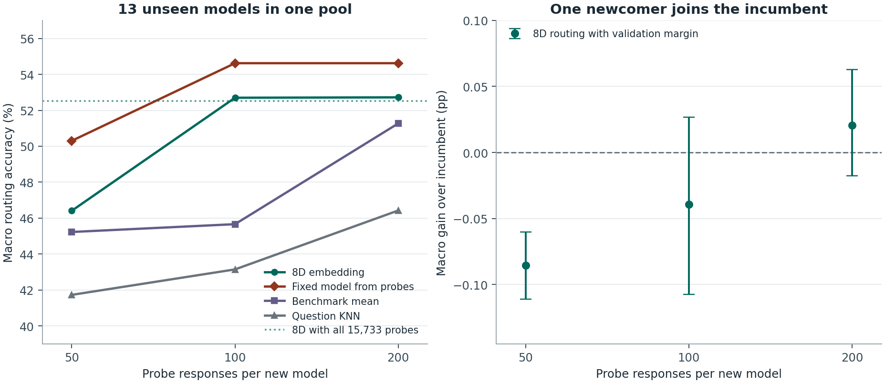

# Efficient LLM Routing with Compact Model Embeddings

Can 50, 100, or 200 binary answers place a new language model inside a router without querying every candidate on future inputs? This NYCU Deep Learning Practice Group 11 project freezes a shared question decoder, infers an 8D vector for each newcomer, and selects one model per query, building on [EmbedLLM: Learning Compact Representations of Large Language Models, ICLR 2025](https://openreview.net/forum?id=Fs9EabmQrJ).

We independently implement EmbedLLM-style few-answer onboarding and test directly when query-level matches overcome an established incumbent. EmbedLLM already performs per-query routing, and prior work on cold-start onboarding includes [UniRoute](https://arxiv.org/abs/2502.08773) and [ZeroRouter](https://arxiv.org/abs/2601.06220).

Offline replay spans 88 models and 22,475 representative questions across five benchmarks (`LogiQA`, `MMLU`, `MathQA`, `MedMCQA`, `TruthfulQA`). It uses 62 training models on 15,733 support items, 13 validation models on 3,372 queries, and 13 test candidates on 3,370 unseen queries across seeds 11, 23, and 37. Because this evaluation reuses test models and questions already scored in the benchmark study, it acts as an exploratory downstream reanalysis even though validation selects all margins and test labels never enter fitting. Efficiency covers probe label budget, 8D storage, and one intended model call per query, leaving live calls, deployment cost, and latency out of scope in [the final report](reports/FINAL_REPORT.md).

## Primary routing results

### Simultaneous all-unseen pool

All 13 held-out models compete on 3,370 unseen queries using 50, 100, or 200 nested balanced-random probes per candidate (650, 1,300, or 2,600 answers across the pool). Hindsight per-query oracle accuracy is 81.40%, expected uniform zero-probe accuracy is 36.23%, and full-support 15,733-probe embeddings reach 52.53%.

| Router (macro accuracy, %) | 50 probes | 100 probes | 200 probes |
| --- | ---: | ---: | ---: |
| Compact embedding, 8D | 46.41 | 52.70 | 52.72 |
| Fixed probe-best candidate | 50.30 | 54.62 | 54.62 |
| Domain probe mean | 45.23 | 45.66 | 51.27 |
| Question KNN | 41.73 | 43.15 | 46.43 |

Compact 8D improves on question KNN and domain probe means, and at 200 probes it gains 0.78 percentage points descriptively over its same-usage within-benchmark shuffle. Yet it trails the probe-best fixed candidate by 1.90 percentage points at 200 probes (conditional 95% query-bootstrap interval [-2.96, -0.88] points). Lowest-ID zero-probe selection reaches 54.62% only because the held-out model with the highest test macro accuracy in this roster happens to carry the lowest source ID. Expanding support from 200 to 15,733 probes leaves macro accuracy nearly flat at 52.53%, as recorded in [the routing summary](reports/routing/test_summary.csv) and [the paired intervals](reports/routing/test_paired.csv).

### Incumbent masking and add-one newcomer rescue or harm

Validation selects `Meta-Llama-3-70B-Instruct` (ID 50, 58.60% test macro accuracy) as the fixed established incumbent facing each of the 13 held-out newcomers independently across 50, 100, or 200 probes per episode (650, 1,300, or 2,600 answers across trials). Across 3,370 queries, each newcomer creates 201.69 rescue opportunities on average.

| Policy (macro accuracy, %) | 50 probes | 100 probes | 200 probes |
| --- | ---: | ---: | ---: |
| Incumbent only | 58.60 | 58.60 | 58.60 |
| Compact embedding, gated | 58.51 | 58.56 | 58.62 |
| Compact embedding, raw argmax | 54.73 | 55.16 | 56.51 |

Raw argmax routes 18.55%, 16.23%, and 13.04% of queries to newcomers and captures 37.31, 32.90, and 26.03 rescues per trial, while inflicting 186.31, 158.85, and 104.54 harms per trial. Validation margins of 0.075, 0.1, and 0.15 suppress most harmful switches, cutting newcomer share to 0.66%, 0.14%, and 0.07% with 0.79, 0.38, and 0.38 rescues versus 5.87, 0.69, and 0.38 harms per trial. At 50 probes gated accuracy drops by 0.09 percentage points, at 200 probes the gated estimate is 0.02 percentage points above the incumbent, with the paired interval crossing zero, and full 15,733-probe gating reaches 58.59% (3.95 rescues vs. 6.28 harms) in [the per-candidate trials](reports/routing/test_add_one_by_candidate.csv) and [the pool selection log](reports/routing/test_pool_selections.csv).



*Macro routing accuracy across 50, 100, and 200 balanced-random probes per candidate. The left panel compares four pool routers across all 13 held-out models alongside the full 15,733-probe 8D reference line. The right panel plots add-one macro gain over the Meta-Llama-3-70B-Instruct incumbent under validation margins with 95% paired, conditional query-bootstrap intervals.*

A separate validation-only pilot comparing balanced random, score-Fisher, D-optimal, and routing-aware expected improvement acquisition at budgets 50 and 100 also produced negative gains under the fixed 0.10 admission margin (-0.13 and -0.04 percentage points vs. balanced random) in [the acquisition pilot](scripts/pilot_routing_acquisition.py) and [the pilot summary](reports/routing/acquisition_pilot/summary.csv). An exploratory validation pilot on support-selected fallback routing also found no general advantage across budgets (+0.44, +2.51, and +0.77 macro points at 50, 100, and 200 probes, with -0.37 micro points at 200) in [the final report](reports/FINAL_REPORT.md) and [the anchored pilot summary](reports/routing/anchored_pilot/summary.csv).

## Secondary study on benchmark-score prediction

Historical macro benchmark-score MAE (percentage points, lower is better) under identical balanced random probes preserves our October evaluation.

| Predictor | 50 responses | 100 responses | 200 responses |
| --- | ---: | ---: | ---: |
| Neural model embedding, 8D | 6.26 | 5.10 | 4.27 |
| Scalar calibrated ability, 1D | 6.20 | 5.61 | 4.78 |
| Smoothed benchmark mean | 6.77 | 6.60 | 6.02 |
| Question KNN | 6.57 | 6.46 | 5.41 |
| Training benchmark mean, zero probes | 6.69 | 6.69 | 6.69 |

The 8D embedding beats smoothed means and degrades under within-benchmark response permutation, while 8D-minus-1D lineage intervals cross zero and semantic diversity hurts at 200 responses. Matched family shifts and an exploratory 8D check show mixed ancestry effects including a Yi gap. An excluded-ID check on 24 models reaches 6.59, 5.57, and 4.74 MAE vs. 6.97, 6.39, and 6.32 for scalar calibration in [the final report](reports/FINAL_REPORT.md).

## Quickstart and single-prompt routing

Install Python 3.10+ with PyTorch, prepare the pinned dataset, train and validate the decoder, and run validation before test routing. A fresh clone trains into `artifacts/reproduction`, while our published numbers come from a separate local `artifacts/main_v2` run outside Git in [the routing runner](scripts/run_routing.py).

```bash
python -m pip install -e ".[dev]"
python -m pytest -q
python scripts/download_data.py
python scripts/prepare_data.py --no-split
python scripts/run_experiment.py --phase train_validate --output artifacts/reproduction --evaluate-validation --save-predictions
python scripts/run_routing.py --run artifacts/reproduction --phase validation --output artifacts/routing_reproduction
python scripts/run_routing.py --run artifacts/reproduction --phase test --output artifacts/routing_reproduction
```

To route a single prompt, first fit a newcomer embedding via `scripts/embed_new_model.py` (`plan` then `infer` with `--variant neural_lowrank` on the same run and seed), optionally install the text encoder packages, and run the query selector.

```bash
python -m pip install "sentence-transformers==5.1.2" "transformers==4.57.1"
python scripts/route_query.py --run artifacts/reproduction --seed 11 --trained-model 50 --candidate-embedding artifacts/new_model/fit/embedding.npz --prompt "What causes the phases of the Moon?"
```

Pass `--question-vector path.npy` to supply a precomputed `all-mpnet-base-v2` vector as an alternative to raw text. Pure low-rank ranking omits `--benchmark` because shared question offsets cancel, while passing `--benchmark` adds probability scores and `--minimum-gain` two-candidate gating. The CLI prints JSON naming one candidate for downstream dispatch, and a validation-prompt check on a 50-probe fit matched the released vector within `5.25e-7` maximum score error and picked the same model in [the query router](scripts/route_query.py).

## Repository guide and related work

| Path | Role |
| --- | --- |
| `src/coldstart/` | Data audit, splits, decoder, Newton MAP adaptation, probes, metrics |
| `scripts/` | Download, preparation, experiment, routing evaluation, single-prompt CLI |
| `configs/` | Protocol locks and family stress configuration |
| `reports/routing/` | Validation selection and test routing tables |
| `reports/FINAL_REPORT.md` | Primary routing evidence and secondary benchmark-score study |
| `docs/` | Model mathematics, prior work, data provenance, independent reviews |
| `tests/` | Numerical, data-boundary, and integration tests |

Related methods include [tinyBenchmarks](https://proceedings.mlr.press/v235/maia-polo24a.html), [Active Evaluation Acquisition](https://proceedings.mlr.press/v267/li25bp.html), [ATLAS](https://proceedings.mlr.press/v306/li26fx.html), and [SkillEval](https://arxiv.org/abs/2610.28767). Dataset card Apache-2.0 metadata does not establish upstream prompt licenses, and detailed source comparisons live in [related work](docs/research/related_work.md), [novelty review](docs/research/novelty_review.md), and [data sources](docs/research/data_sources.md).
