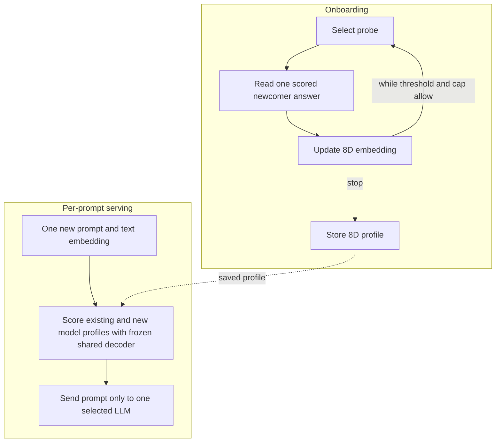

# Efficient LLM Routing with Compact Model Embeddings

This NYCU Deep Learning Practice Group 11 project freezes an EmbedLLM-style decoder, fits an 8D newcomer profile from answers, automatically chooses probes and when to stop, and independently selects one LLM for each incoming prompt, building on [EmbedLLM: Learning Compact Representations of Large Language Models, ICLR 2025](https://openreview.net/forum?id=Fs9EabmQrJ). EmbedLLM routes per query with trained model IDs, while [UniRoute](https://arxiv.org/abs/2502.08773) and [ZeroRouter](https://arxiv.org/abs/2601.06220) onboard unseen models.

Core offline evaluations reuse scored historical tests across 88 models and 22,475 questions without deployment cost or latency claims. At 200 probes, choosing the decoder by validation routing accuracy gains +3.53 and +3.48 macro pp over score-MAE selection on 13 and 37 models, yet trails fixed baselines on 13 models (-0.80 pp) with an uncertain +0.61 pp gap on 37 models, alongside LLMRouterBench results in [the final report](reports/FINAL_REPORT.md).

Adaptive onboarding reduces probes by 77.3% against the strongest incumbent (ID 50, mean 45.44, 58.54% versus 58.60% incumbent), yet saves only 5.5% across three competitive anchors (mean 189.05) and trails balanced-random stopping by -0.10 pp in [the competitive summary](reports/routing/competitive_onboarding/test_summary.csv). On xRouteBench, both smooth and random arms stop at 10 identical warm-up probes with 0% savings, leaving post-warmup selection untested in [the xRouteBench summary](reports/routing/xroute_onboarding/test_summary.csv).

In a live GPU integration check on ARC-Challenge, smooth onboarding stopped after 19 newcomer probes and made exactly one actual call for each of 24 prompts, routing all 24 to the incumbent in [the live demo summary](reports/routing/live_demo/demo.json) and [the dispatch log](reports/routing/live_demo/dispatch.csv). This confirms end-to-end execution without establishing routing accuracy.



## Primary routing results

### Simultaneous all-unseen pool

All 13 held-out models compete on 3,370 unseen queries using 50, 100, or 200 nested balanced-random probes per candidate (650, 1,300, or 2,600 answers across the pool). Hindsight per-query oracle accuracy is 81.40%, expected uniform zero-probe accuracy is 36.23%, and full-support 15,733-probe embeddings reach 52.53%.

| Router (macro accuracy, %) | 50 probes | 100 probes | 200 probes |
| --- | ---: | ---: | ---: |
| Compact embedding, 8D | 46.41 | 52.70 | 52.72 |
| Fixed probe-best candidate | 50.30 | 54.62 | 54.62 |
| Domain probe mean | 45.23 | 45.66 | 51.27 |
| Question KNN | 41.73 | 43.15 | 46.43 |

Compact 8D improves on question KNN and domain probe means, and at 200 probes it gains 0.78 percentage points descriptively over its same-usage within-benchmark shuffle. Yet it trails the probe-best fixed candidate by 1.90 percentage points at 200 probes (conditional 95% query-bootstrap interval [-2.96, -0.88] points). Lowest-ID zero-probe selection reaches 54.62% only because the held-out model with the highest test macro accuracy in this roster happens to carry the lowest source ID. Expanding support from 200 to 15,733 probes leaves macro accuracy nearly flat at 52.53%, as recorded in [the routing summary](reports/routing/test_summary.csv) and [the paired intervals](reports/routing/test_paired.csv).

### Incumbent masking and add-one newcomer rescue or harm

Validation selects `Meta-Llama-3-70B-Instruct` (ID 50, 58.60% test macro accuracy) as the fixed established incumbent facing each of the 13 held-out newcomers independently across 50, 100, or 200 probes per episode (650, 1,300, or 2,600 answers across trials). Across 3,370 queries, each newcomer creates 201.69 rescue opportunities on average.

| Policy (macro accuracy, %) | 50 probes | 100 probes | 200 probes |
| --- | ---: | ---: | ---: |
| Incumbent only | 58.60 | 58.60 | 58.60 |
| Compact embedding, gated | 58.51 | 58.56 | 58.62 |
| Compact embedding, raw argmax | 54.73 | 55.16 | 56.51 |

Raw argmax routes 18.55%, 16.23%, and 13.04% of queries to newcomers and captures 37.31, 32.90, and 26.03 rescues per trial, while inflicting 186.31, 158.85, and 104.54 harms per trial. Validation margins of 0.075, 0.1, and 0.15 suppress most harmful switches, cutting newcomer share to 0.66%, 0.14%, and 0.07% with 0.79, 0.38, and 0.38 rescues versus 5.87, 0.69, and 0.38 harms per trial. At 50 probes gated accuracy drops by 0.09 percentage points, at 200 probes the gated estimate is 0.02 percentage points above the incumbent, with the paired interval crossing zero, and full 15,733-probe gating reaches 58.59% (3.95 rescues vs. 6.28 harms) in [the per-candidate trials](reports/routing/test_add_one_by_candidate.csv) and [the pool selection log](reports/routing/test_pool_selections.csv).


*Macro routing accuracy across 50, 100, and 200 balanced-random probes per candidate. The left panel compares four pool routers across all 13 held-out models alongside the full 15,733-probe 8D reference line. The right panel plots add-one macro gain over the Meta-Llama-3-70B-Instruct incumbent under validation margins with 95% paired, conditional query-bootstrap intervals.*

A separate validation-only pilot comparing balanced random, score-Fisher, D-optimal, and routing-aware expected improvement acquisition at budgets 50 and 100 also produced negative gains under the fixed 0.10 admission margin (-0.13 and -0.04 percentage points vs. balanced random) in [the acquisition pilot](scripts/pilot_routing_acquisition.py) and [the pilot summary](reports/routing/acquisition_pilot/summary.csv). An exploratory validation pilot on support-selected fallback routing also found no general advantage across budgets (+0.44, +2.51, and +0.77 macro points at 50, 100, and 200 probes, with -0.37 micro points at 200) in [the final report](reports/FINAL_REPORT.md) and [the anchored pilot summary](reports/routing/anchored_pilot/summary.csv).

## Secondary study on benchmark-score prediction

Historical macro benchmark-score MAE (percentage points, lower is better) under identical balanced random probes preserves our October evaluation.

| Predictor | 50 responses | 100 responses | 200 responses |
| --- | ---: | ---: | ---: |
| Neural model embedding, 8D | 6.26 | 5.10 | 4.27 |
| Scalar calibrated ability, 1D | 6.20 | 5.61 | 4.78 |
| Smoothed benchmark mean | 6.77 | 6.60 | 6.02 |
| Question KNN | 6.57 | 6.46 | 5.41 |
| Training benchmark mean, zero probes | 6.69 | 6.69 | 6.69 |

The 8D embedding beats smoothed means and degrades under within-benchmark response permutation, while 8D-minus-1D lineage intervals cross zero and semantic diversity hurts at 200 responses. Matched family shifts and an exploratory 8D check show mixed ancestry effects including a Yi gap. An excluded-ID check on 24 models reaches 6.59, 5.57, and 4.74 MAE vs. 6.97, 6.39, and 6.32 for scalar calibration in [the final report](reports/FINAL_REPORT.md).

## Quickstart and single-prompt routing

Install Python 3.10+ with PyTorch, prepare the pinned dataset, train and validate the decoder, and run validation before test routing. A fresh clone trains into `artifacts/reproduction`, while our published numbers come from a separate local `artifacts/main_v2` run outside Git in [the routing runner](scripts/run_routing.py).

```bash
python -m pip install -e ".[dev]"
python -m pytest -q
python scripts/download_data.py
python scripts/prepare_data.py --no-split
python scripts/run_experiment.py --phase train_validate --output artifacts/reproduction --evaluate-validation --save-predictions
python scripts/run_routing.py --run artifacts/reproduction --phase validation --output artifacts/routing_reproduction
python scripts/run_routing.py --run artifacts/reproduction --phase test --output artifacts/routing_reproduction
```

Optional two-step reproduction for the checkpoint-selection and softmax-regret study in [the routing-learning script](scripts/pilot_routing_learning.py) uses `--run`, `--checkpoints`, and `--output` on a fresh clone so `artifacts/reproduction` feeds both phases while checked-in reports remain untouched.

```bash
python scripts/pilot_routing_learning.py --phase train_validate --run artifacts/reproduction --checkpoints artifacts/reproduction_learning --output artifacts/routing_learning_reproduction
python scripts/pilot_routing_learning.py --phase test --run artifacts/reproduction --checkpoints artifacts/reproduction_learning --output artifacts/routing_learning_reproduction
```

To route a single prompt, first fit a newcomer embedding via `scripts/embed_new_model.py` (`plan` then `infer` with `--variant neural_lowrank` on the same run and seed), optionally install the text encoder packages, and run the query selector.

```bash
python -m pip install "sentence-transformers==5.1.2" "transformers==4.57.1"
python scripts/route_query.py --run artifacts/reproduction --seed 11 --trained-model 50 --candidate-embedding artifacts/new_model/fit/embedding.npz --prompt "What causes the phases of the Moon?"
```

Pass `--question-vector path.npy` to supply a precomputed `all-mpnet-base-v2` vector as an alternative to raw text. Default inference with no `--benchmark` and no positive `--minimum-gain` retains raw interaction `argmax` because shared offsets cancel, passing `--benchmark` adds probability scores and optional `--minimum-gain` two-candidate gating using that domain's bias, and passing any positive `--minimum-gain` with exactly two candidates and no `--benchmark` uses the arithmetic mean of learned benchmark biases as the logit offset component (the same fallback as external replay) to gate an incoming prompt with no manually supplied benchmark using probabilities that remain uncalibrated for arbitrary traffic. The CLI prints JSON naming one candidate for downstream dispatch, and a validation-prompt check on a 50-probe fit matched the released vector within `5.25e-7` maximum score error and picked the same model in [the query router](scripts/route_query.py).

The previous workflow still works with the legacy checkpoint. For the routing-selected BCE model, plan probes with `scripts/embed_new_model.py plan`, have the model provider or user fill binary `response` values in `artifacts/new_model/probes.csv` for the new LLM, and use the same checkpoint for `fit` and routing in `scripts/route_query.py` (using the earlier text-encoder install step for raw text).

```bash
python scripts/embed_new_model.py plan --run artifacts/reproduction --variant neural_lowrank --seed 11 --budget 200 --output artifacts/new_model/probes.csv
python scripts/route_query.py fit --run artifacts/reproduction --checkpoint artifacts/reproduction_learning/checkpoints/B_bce_routing_selection_11.pt --responses artifacts/new_model/probes.csv --model-name my_model --output artifacts/new_model/routing_embedding.npz
python scripts/route_query.py --run artifacts/reproduction --checkpoint artifacts/reproduction_learning/checkpoints/B_bce_routing_selection_11.pt --trained-model 50 --candidate-embedding artifacts/new_model/routing_embedding.npz --prompt "What causes the phases of the Moon?"
```

As an alternative to `--prompt`, `--stdin` consumes one nonempty prompt per line and emits one independent JSON choice per line while reusing the decoder and text encoder, and optional `--question-vector` remains available for saved features. For multiline prompts, use `scripts/route_query.py --stdin-json` instead of `--stdin` with the same flags. `--stdin-json` treats each nonblank line as one JSON object with a single `prompt` string such as `{"prompt":"Find x.\n2x + 7 = 13"}`, supports embedded newline escapes, and prints one model choice per line. Optional `--learning-selection` supplies a custom `selection.json` for older routing-learning checkpoint metadata. These commands select which model should answer, with the caller handling generation separately.

### Adaptive onboarding

Start sequential onboarding for a newcomer to receive a `next_probe` JSON payload containing `prompt_id`, `prompt` text, and `benchmark`.

```bash
python scripts/onboard_model.py --model-name my_model --episode-id 42 --seed 11 --embedding artifacts/new_model/adaptive_embedding.npz
```

For `scripts/onboard_model.py`, `--selector` accepts `exact`, `random`, or `smooth` with `exact` as the default, where `smooth` uses rank-one decision-weighted selection with no hypothetical MAP solves. All three use the frozen `0.0003` EVPI threshold by default and accept `--evpi-tolerance` overrides, with `0` requesting up to `200` probes. Optional `--incumbent-model-id` chooses an established training model. Keep the same incumbent ID, seed, episode ID, selector, and threshold for every invocation of a history. Below, `0.002` is a validation example whose external result did not beat balanced random in [the final report](reports/FINAL_REPORT.md).

```bash
python scripts/onboard_model.py --model-name my_model --episode-id 42 --seed 11 --selector smooth --evpi-tolerance 0.002 --incumbent-model-id 3 --embedding artifacts/new_model/smooth_embedding.npz
```

Obtain the model's answer externally, append its binary correctness under `prompt_id,response` in `artifacts/new_model/adaptive_responses.csv`, and rerun the exact first command with `--responses artifacts/new_model/adaptive_responses.csv` and the same episode ID and seed, repeating until stopping. A `stop` response writes the newcomer embedding alongside `adaptive_embedding.incumbent.npz` and reports the checkpoint, stop reason, and margin.

For a persistent session that keeps the decoder and data loaded across probes, add `--stdin`. Each `next_probe` payload arrives as one JSON object per line on standard output, and the caller replies on standard input with one JSON line containing an integer `prompt_id` matching the emitted ID and an integer `response` equal to `0` or `1`. Reaching `stop` writes the same two embeddings and prints the final `stop` JSON line. Save a chronological `prompt_id,response` history externally if resuming with `--responses prefix.csv` and identical settings.

```bash
python scripts/onboard_model.py --stdin --model-name my_model --episode-id 42 --seed 11 --embedding artifacts/new_model/adaptive_embedding.npz
```

Apply the gate to choose one model per prompt with `scripts/route_query.py`.

```bash
python scripts/route_query.py --run artifacts/main_v2 --checkpoint artifacts/routing_learning/checkpoints/B_bce_routing_selection_11.pt --candidate-embedding artifacts/new_model/adaptive_embedding.incumbent.npz --candidate-embedding artifacts/new_model/adaptive_embedding.npz --minimum-gain 0.025 --prompt "What causes the phases of the Moon?"
```

Both steps reuse the same trained files or take fresh overrides via `--run`, `--checkpoints`, `--selection`, and `--learning-selection`, keeping the same decoder for both (`--checkpoint` in `scripts/route_query.py`). The CLI yields choices, and the external caller submits model generation and scoring. When an incoming prompt has no manually supplied `--benchmark`, any positive `--minimum-gain` with exactly two candidates uses the arithmetic mean of learned benchmark biases as the logit offset component (the same fallback as external replay) to compute gating probabilities that remain uncalibrated for arbitrary traffic, and omitting both `--benchmark` and a positive `--minimum-gain` retains raw interaction `argmax` by default.

An end-to-end local integration demo in [the live routing demo script](scripts/demo_live_routing.py) runs live onboarding and query dispatch on GPU using the documented PyTorch environment plus `sentence-transformers`, `transformers`, and `pyarrow` against pinned `ARC-Challenge` data and public Hugging Face checkpoints, with checked-in records in [the live demo summary](reports/routing/live_demo/demo.json) and [the dispatch log](reports/routing/live_demo/dispatch.csv).

```bash
python scripts/demo_live_routing.py --output artifacts/live_demo_reproduction
```

## Repository guide and related work

| Path | Role |
| --- | --- |
| `src/coldstart/` | Data audit, splits, decoder, Newton MAP adaptation, probes, metrics |
| `scripts/` | Download, preparation, experiment, routing evaluation, single-prompt CLI |
| `configs/` | Protocol locks and family stress configuration |
| `reports/routing/` | Validation selection and test routing tables |
| `reports/FINAL_REPORT.md` | Primary routing evidence and secondary benchmark-score study |
| `docs/` | Model mathematics, prior work, data provenance, independent reviews |
| `tests/` | Numerical, data-boundary, and integration tests |

Related methods include [softmax regret routing](https://arxiv.org/abs/2505.16037), [few-observation LLM profiles](https://arxiv.org/abs/2609.37362), [tinyBenchmarks](https://proceedings.mlr.press/v235/maia-polo24a.html), [Active Evaluation Acquisition](https://proceedings.mlr.press/v267/li25bp.html), [ATLAS](https://proceedings.mlr.press/v306/li26fx.html), and [SkillEval](https://arxiv.org/abs/2610.28767). Dataset card Apache-2.0 metadata does not establish upstream prompt licenses, and detailed source comparisons live in [related work](docs/research/related_work.md), [novelty review](docs/research/novelty_review.md), and [data sources](docs/research/data_sources.md).
