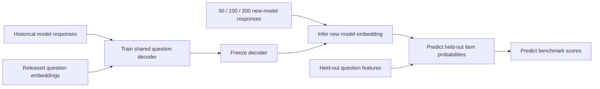

# Learning Model Embeddings from Few Responses

Can a new language model's answers to **50, 100, or 200 questions** tell us how it
will perform on other questions? This project learns a compact model embedding
from those responses and uses it to predict benchmark scores.

This is Group 11's NYCU Deep Learning Practice final project. It extends the
research question behind [EmbedLLM (ICLR 2025)](https://openreview.net/forum?id=Fs9EabmQrJ)
with cold-start inference, audited data, controlled probe selection, and
comparisons that test whether a learned embedding adds value beyond simple
score summaries. The implementation is written independently; it is not an
exact reproduction of the original code or a claim to have invented few-shot
model evaluation.

**Status:** the data audit and implementation are complete enough for validation.
Real-data experiments are being run; performance claims will be added only
after the experiment configuration is frozen and test evaluation is complete.

## What the system learns

Training uses historical binary response records and the released question
embeddings. A small neural network maps question text features to a difficulty
term and an interaction vector. We compare an eight-dimensional neural
embedding with a structured variant containing:

- a global response tendency;
- one residual for each benchmark;
- eight learned interaction coordinates.

For a new model, we freeze the shared network and fit only that model's vector
with regularized logistic regression. The objective is convex in the new vector;
a Newton solver returns the embedding and a local posterior covariance.
Predicted item probabilities are averaged to estimate each benchmark score.
Benchmark residuals are statistical coordinates, not established human skills.
The neural eight-dimensional variant is the primary candidate selected on
development validation data; the structured variant and its rank-zero ablation
remain in every primary comparison.



## Research questions and controls

1. Does the learned interaction vector improve on a global/benchmark-only
   embedding, a scalar calibrated ability, smoothed response means, and
   question-neighbor prediction?
2. Do balanced probes or semantic diversity improve score prediction?
3. Does choosing probes to reduce approximate benchmark-score variance help?
4. Does removing a new model's relatives from the training pool change results
   when target models and training-pool size stay fixed?

The probe policies are random, benchmark-balanced random, semantic diversity,
balanced diversity, score-aware Fisher selection, and balanced Fisher selection.
All predictors evaluated under a policy receive the same revealed responses.
The Fisher rule uses a reference bank drawn only from training/support questions.
It is a local uncertainty approximation, not a guarantee of lower error.

The scalar baseline shifts each training benchmark's log-odds by one fitted
ability value. It retains known benchmark difficulty while sharing information
across sources, providing a stronger control than a single raw response mean.

A response-permutation diagnostic preserves each observed benchmark's score
while breaking item-response alignment. It tests whether the residual embedding
uses more information than those score totals. Permutation occurs **after**
restricting responses to the declared budget.

## Data and evaluation boundaries

We pin [RZ412/EmbedLLM](https://huggingface.co/datasets/RZ412/EmbedLLM)
at revision `266ae3e180ccb533c86afc9cfb2f5db99d171aea` and verify downloaded
file sizes and SHA-256 hashes. The complete CSV audit covers 4,586,288 records
for 112 models and 35,673 prompt IDs. It finds 553,616 duplicated model/prompt
cells and 77,581 cells with conflicting labels. Every released tensor label
equals the maximum of its raw records; this describes the release, not the
correct scoring rule for the original model output.

The primary analysis uses MMLU, MedMCQA, MathQA, TruthfulQA, and LogiQA, with
exactly one raw record per retained model/prompt. We retain models with reviewed
family evidence, group detected question variants, and choose a deterministic
representative per group before splitting. The frozen cohort has **88 models and
22,475 representative questions**. Raw prompts, responses, and large
tensors are not included in this repository.

Both model IDs and question groups are held out. **Final target-item labels are
unavailable for every training model.** Only validation models and validation
items select hyperparameters. Test execution requires a matching lock of the
configuration, splits, data, implementation, and trained checkpoints.

The primary metric is macro benchmark-score MAE. We also report per-benchmark
error, worst-benchmark error, Brier score, and adaptation time. Seeds are averaged
within models before uncertainty estimation; family-aware intervals remain
descriptive when there are few independent groups.

These are offline predictions on a retained prompt subset, not official complete
benchmark scores. The common subset uses record-count metadata from held-out
models, and original evaluator versions, generation conditions, and full source
item IDs are unavailable. Detected-group separation cannot rule out every
paraphrase or historical LLM training contamination.

## Run locally

Use Python 3.10 or later. Install a [PyTorch build compatible with your hardware](https://pytorch.org/get-started/locally/),
then install this project:

```bash
python -m pip install -e ".[dev]"
python -m pytest -q
python scripts/download_data.py
python scripts/prepare_data.py --no-split
```

The downloader retrieves about 3.4 GB, verifies a pinned revision, and reuses
verified files. Preparation scans the full raw CSV and writes compact arrays,
audit records, and question-group metadata under `data/processed/`.

Train and choose hyperparameters without evaluating test targets:

```bash
python scripts/run_experiment.py --phase train_validate --output artifacts/main --evaluate-validation
```

Review the validation artifacts and frozen protocol, then evaluate and generate
the report:

```bash
python scripts/run_experiment.py --phase test --output artifacts/main --save-predictions
python scripts/report_results.py --run artifacts/main --output reports/main
```

Use `--deadline` with a timezone-aware ISO timestamp to bound a run. Completed
checkpoints can be reused with `--resume`; mismatched data, configuration, or
splits are rejected. See each script's `--help` for development overrides.

## Embed another model

After training and validation, export a short question set:

```bash
python scripts/embed_new_model.py plan --run artifacts/main --variant neural_lowrank --budget 50 --output artifacts/new_model/probes.csv
```

Evaluate the new model on those prompts and fill the `response` column with
binary correctness (`0` or `1`). The script does not call an LLM API or grade
free-form answers. Then infer its embedding:

```bash
python scripts/embed_new_model.py infer --run artifacts/main --variant neural_lowrank --responses artifacts/new_model/probes.csv --model-name my_model --output artifacts/new_model/fit
```

The output contains a reusable `embedding.npz`, its decoder checksum, and
`prediction.json` with benchmark-subset predictions. An embedding belongs to
its trained decoder; coordinates from separate checkpoints are not directly
interchangeable. Compatibility with a new evaluation's scoring conditions
must be assessed because the source release lacks full evaluator provenance.

## Repository guide

| Path | Purpose |
| --- | --- |
| `src/coldstart/` | Data audit, splits, decoder, MAP inference, probe selection, metrics |
| `scripts/` | Download, preparation, experiment execution, reporting, runtime control |
| `configs/protocol.json` | Evaluation rules, model settings, budgets, and controls |
| `data/metadata/` | Reviewed family assignments and pinned evidence |
| `docs/design/` | Model mathematics and evaluation protocol |
| `docs/research/` | Related work, novelty assessment, and data provenance |
| `docs/reviews/` | Independent mathematical and implementation reviews |
| `reports/` | Small, shareable result tables and figures |
| `tests/` | Numerical, leakage-boundary, and integration checks |

## Related work and attribution

Relevant work includes [EmbedLLM](https://openreview.net/forum?id=Fs9EabmQrJ),
[tinyBenchmarks](https://proceedings.mlr.press/v235/maia-polo24a.html),
[Active Evaluation Acquisition](https://proceedings.mlr.press/v267/li25bp.html),
[ATLAS](https://proceedings.mlr.press/v306/li26fx.html), and
[SkillEval](https://arxiv.org/abs/2610.28767).
Cold-start profiles, empirical priors, adaptive testing, and family holdout all
have prior art. Our contribution is an implemented, audited, controlled study
on this dataset; improvements must be demonstrated experimentally.

See [related work](docs/research/related_work.md),
[novelty assessment](docs/research/novelty_review.md), and
[data sources](docs/research/data_sources.md) for source-specific comparisons.
The dataset card's Apache-2.0 declaration does not establish that every upstream
benchmark prompt or the separate original code has the same license.

