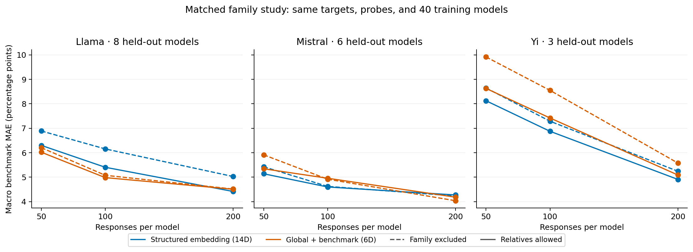
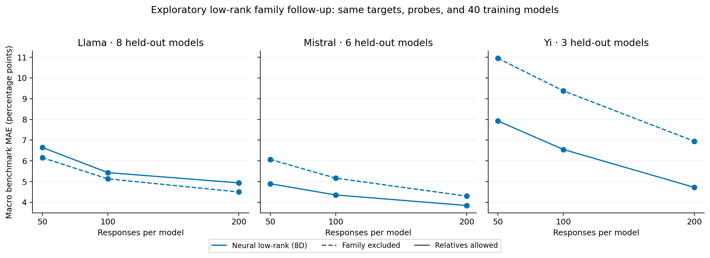

# Learning Model Embeddings from Few Responses

NYCU Deep Learning Practice, Group 11. Experiment date: 2026-10-28.

## Main finding

A frozen neural question decoder can infer a useful eight-dimensional model
embedding from 50–200 binary responses. On 13 held-out models, its benchmark
score MAE with balanced random probes falls from **6.26 to 4.27 percentage
points** as the budget rises from 50 to 200. The learned predictor improves on
smoothed benchmark averages, and its predictions use item-response alignment
beyond benchmark response totals. A strong one-dimensional calibration baseline
is competitive: the present sample does not establish a reliable advantage for
eight dimensions over one.

Score-aware Fisher acquisition helps relative to global random selection at
100 and 200 responses. Balanced and diversity policies have mixed outcomes.
These findings support an implemented course extension and an empirical study;
they do not establish a new state of the art or a first solution to cold-start
model profiling.

## Data and target

We use the released question vectors and binary response records from
[EmbedLLM](https://openreview.net/forum?id=Fs9EabmQrJ), pinned at Hugging Face
revision `266ae3e180ccb533c86afc9cfb2f5db99d171aea`.

The complete audit covers **4,586,288 CSV records** and every cell of the
112-model × 35,673-prompt matrix. There are 553,616 duplicated model/prompt
cells and 77,581 cells containing conflicting labels. Every released tensor
label equals the maximum of its corresponding raw records. This is an observed
release property; the original outputs, evaluator versions, and scoring filters
are unavailable, so it does not establish which raw record should be trusted.

The primary subset requires exactly one raw record per model/prompt in MMLU,
MedMCQA, MathQA, TruthfulQA, and LogiQA. Selection uses row structure, not which
labels make a method successful. The structural eligibility pattern is identical
across all 112 released models. After restricting models to 88 with reviewed
family evidence and retaining one deterministic representative per detected
question group, the cohort contains **22,475 questions**.

Question grouping handles detected subject-header, option-order, and repeated
stem variants. Conservative stem grouping can merge distinct questions, while
unrecognized paraphrases can remain. Thus the target is the released binary
label on this representative subset, rather than an official complete benchmark
score. Source alignment also identifies the released MedMCQA questions as its
upstream validation split. Detailed counts and evidence are in the
[data audit](data_audit/summary.json) and
[source review](../docs/research/data_sources.md).

## Method and information boundary

A small neural network maps released question embeddings to an offset and a
feature vector. With the shared network frozen, a model's response probability
has the form `sigmoid(offset(question) + feature(question)ᵀ model_embedding)`.
The new embedding minimizes the sum of Bernoulli negative log likelihoods plus
a Gaussian prior fitted from training-model embeddings. Its adaptation objective
is convex; a Newton solver updates only the new vector.

We compare a neural low-rank embedding (8 coordinates), an explicit global plus
benchmark embedding (6 coordinates), and a structured extension combining those
coordinates with eight interactions (14 coordinates). Controls include smoothed
benchmark response means, question KNN, and a scalar logit shift that preserves
known benchmark difficulty. All predictors under a policy observe exactly the
same selected responses. No model names or family labels enter the decoder.

The primary split has **62 training, 13 validation, and 13 test models**;
question groups are divided into **15,733 support/training, 3,372 validation,
and 3,370 final-test items**. Final-item labels are masked for every historical
training model. The frozen decoder reads final question features for prediction,
while acquisition uses only support-pool candidates and a fixed reference bank
of 64 training items per benchmark. No target correctness guides selection.

An eight-configuration search selected one shared neural training setting on
validation data. The primary candidate was selected before final testing.
Three seeds train separate decoders and probe paths. Final execution verifies
locks for data bytes, model/item splits, configuration, implementation, and
checkpoints. Historical training uses 975,446 binary response cells; the 50–200
budget counts new-model adaptation responses, not all historical collection.

## Main test results

Macro MAE first averages absolute score error equally over the five benchmarks,
then averages models. The table uses identical balanced random probes. All
entries are **percentage points**; lower is better.

| Predictor | 50 responses | 100 responses | 200 responses |
| --- | ---: | ---: | ---: |
| Neural low-rank embedding, 8D | 6.26 | 5.10 | 4.27 |
| Global + benchmark embedding, 6D | 6.77 | 5.77 | 4.77 |
| Structured embedding, 14D | 6.83 | 5.65 | 4.57 |
| Scalar calibrated ability, 1D | 6.20 | 5.61 | 4.78 |
| Smoothed benchmark response mean | 6.77 | 6.60 | 6.02 |
| Question KNN | 6.57 | 6.46 | 5.41 |
| Training benchmark mean, zero responses | 6.69 | 6.69 | 6.69 |

At 100 responses, neural minus scalar MAE is −0.512 points, with a descriptive
95% lineage-bootstrap interval of [−1.257, +0.653]. At 200 it is −0.506 points
with [−1.573, +0.419]. These intervals cross zero. The eight-dimensional model
has lower point error at those budgets, but dimensionality itself is not a
demonstrated population advantage. Its gain over same-probe benchmark averages
is clearer. The proposed explicit structured extension also lacks a consistent
advantage over its rank-zero control.

Seeds are averaged within models before resampling. The 13 test models belong
to only **five reviewed lineage groups**, including nine Llama-series models;
intervals are descriptive and no multiple-comparison correction is applied.
They should not be read as precise population guarantees.

### Does the embedding use more than score totals?

The negative control permutes already observed responses within each benchmark,
after slicing to the declared budget. It preserves selected questions, answer
counts, and benchmark totals, while breaking their item alignment.

For the primary neural embedding, permutation raises MAE by **0.188, 0.760,
and 0.912 points** at 50/100/200 responses. The corresponding descriptive
lineage intervals exclude zero. Rank zero is exactly invariant, as its design
predicts. This supports useful item-response information in the neural vector;
it does not establish superiority over the scalar comparator. The structured
variant's permuted point scores are slightly better than its original scores.

### Which probes help?

| Policy for the same 8D predictor | 50 responses | 100 responses | 200 responses |
| --- | ---: | ---: | ---: |
| Random | 5.42 | 5.23 | 4.94 |
| Balanced random | 6.26 | 5.10 | 4.27 |
| Semantic diversity | 5.69 | 5.40 | 5.44 |
| Balanced diversity | 5.96 | 5.57 | 5.48 |
| Score-aware Fisher | 5.46 | 4.82 | 4.46 |
| Balanced score-aware Fisher | 5.48 | 5.09 | 4.45 |

Global Fisher reduces MAE relative to global random by 0.410 and 0.481 points at
100 and 200 responses. The paired descriptive intervals exclude zero at those
budgets. It does not win at 50, and balanced Fisher has no clear advantage over
balanced random. At 200, balanced diversity is worse than balanced random by
1.201 points. Uncertainty, balance, and semantic coverage are therefore not
interchangeable objectives, and none guarantees the best realized score error.

The Fisher rule minimizes a local approximation to reference-bank score
variance. Decoder error and distribution mismatch remain outside that
approximation. Runtime records cover offline selection and inference; the study
does not measure live LLM query costs or monetary savings.

### Failure cases

At 200 balanced probes, TruthfulQA has the primary method's largest mean
benchmark error, 6.28 points, and a mean signed error of −5.06 points. One
example is OpenBuddy's CodeLlama-based model: the held-out TruthfulQA score is
45.90%, versus a seed-averaged prediction of 34.36%. Gemma-2b-it's MMLU score
is 28.23%, versus 37.37% predicted. These are retained failures, not examples
used to choose the data or tune the method.

## Matched family study

The original family study holds test models, Qwen validation models, item groups,
probe IDs, and the 40-model training count fixed within each pair. It swaps
8, 8, or 6 related training models for unrelated ones in the Llama, Mistral,
and Yi cases. Target counts are 8, 6, and 3. The fixed family preset differs
from the main validation-selected configuration, so absolute main-versus-family
errors are not an ancestry effect.

At 200 probes, excluded-minus-relatives-allowed MAE gaps are:

| Family case | Structured 14D | Global + benchmark 6D |
| --- | ---: | ---: |
| Llama | +0.611 | +0.008 |
| Mistral | −0.041 | −0.146 |
| Yi | +0.334 | +0.489 |

Positive values mean relatives helped. Effects vary across cases and methods.
Replacing training models changes more than ancestry, so these are composition
sensitivities, not causal effects. Per-family lineage intervals are suppressed;
there is only one lineage block per case. See the
[complete paired report](family/RESULTS.md).

### Exploratory coverage of the primary 8D architecture

A separate follow-up adds the neural low-rank architecture with the original
family preset and identical target, support, and training-pool splits. Its
dedicated configuration was created after main-test inspection; architecture
selection also used main validation models that include family targets 44 and
47. It is therefore exploratory and does not make model-side family-blind
selection claims. Only paired Qwen validation scores choose its prior strength.

| Family case, 200 probes | Family excluded MAE | Relatives allowed MAE | Gap |
| --- | ---: | ---: | ---: |
| Llama | 4.500 | 4.938 | −0.438 |
| Mistral | 4.299 | 3.846 | +0.453 |
| Yi | 6.944 | 4.719 | +2.225 |

All values are percentage points. The Yi case exposes a transfer weakness in
the learned profile despite its favorable main-test result. The Llama case
also shows why family exclusion cannot be assumed to hurt every representation.
These are descriptive results on small, related target groups.

The [separate follow-up report](family_lowrank_secondary/RESULTS.md) preserves
its scope and avoids counting copied baseline rows as new evidence.

### Rejected validation-only adaptive blend

The family weakness motivated a bounded, post-primary pilot of conditional
Laplace-evidence-weighted MAP predictions from the 8D and 6D decoders. Both
profiles used the same observed responses. Averaged over the existing validation
models, seeds, and budgets, its MAE was 4.985 points, versus 4.889 for a fixed
50/50 blend and 4.997 for the 8D parent. It failed the stronger fixed-blend
control and was rejected without temperature tuning or adding a new predictor
to the held-out-ID coverage experiment. This is a validation-only negative
result; no new final-test success is claimed. See the
[closed-candidate review](../docs/reviews/evidence_blend_review.md) and
[reproduction script](../scripts/analyze_hybrid_pilot.py).

### Frozen coverage of the remaining 24 model IDs

The final coverage check uses every model ID originally excluded for insufficient
or mixed lineage evidence. It keeps the main checkpoints, training priors,
normalization, probe orders, and selected settings fixed, with no training or
tuning on these 24 models. All 24 and all five benchmarks remain in the scored
output. The new cohort's 8D balanced-random MAE is **6.593, 5.574, and 4.735
points** at 50/100/200 responses, versus **6.967, 6.392, and 6.320** for scalar
calibration and 8.977 for the zero-probe prior.

This provides additional descriptive held-out-ID evidence for the frozen
predictor. It uses the same release and target questions, not an external
dataset or newly queried models. Unknown weight ancestry prevents a family-blind
claim and a defensible lineage interval, so no confidence intervals are reported
and the cohort is not pooled with the primary 13-model inferential sample.
See [the full coverage report](metadata_excluded/README.md).

## Contribution and practical limits

Existing work, including [tinyBenchmarks](https://proceedings.mlr.press/v235/maia-polo24a.html),
[AEA](https://proceedings.mlr.press/v267/li25bp.html),
[ATLAS](https://proceedings.mlr.press/v306/li26fx.html), and
[SkillEval](https://arxiv.org/abs/2610.28767), already studies compact profiles,
few-response evaluation, priors, and adaptive probes. The implementation is an
independent EmbedLLM-inspired extension, rather than a faithful reproduction of
its original architecture or an external leaderboard comparison.

The course contribution is the implemented convex adaptation path, complete
release audit, controlled representation and probe comparisons, response
alignment diagnostic, and matched training-composition experiment. The measured
result is useful prediction with clear limits: vector dimensionality and the
proposed structured residual are not established improvements over strong small
controls, and semantic diversity can hurt.

The release contains historical models and five retained benchmark sources.
Original evaluation conditions and exact weight revisions are unresolved;
detected grouping cannot rule out all paraphrases or pretraining contamination.
An external-model CLI accepts user-supplied binary correctness and saves a
decoder-bound embedding with benchmark-subset predictions. Its existing-model
replay verifies the software path; it does not add live evaluation evidence for
an entirely new LLM.

The [README](../README.md) gives runnable commands. Raw data and local trained
checkpoints remain outside Git; result rows, evidence, configuration, locks,
source checksums, and figures support review and reproduction.
