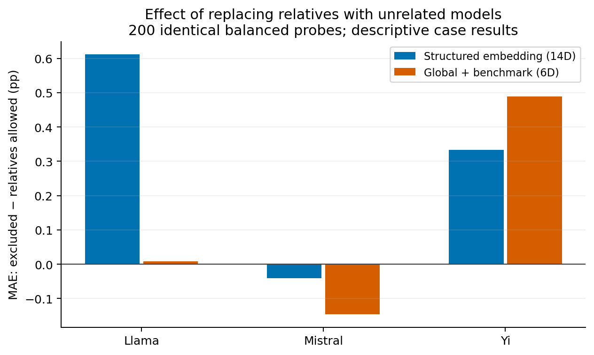

# Matched family study

Both conditions use the same held-out models, Qwen validation models, question groups,
probe IDs, and training-pool size (40). The treatment changes which historical models
fill part of that pool. Positive gaps mean allowing relatives reduced MAE.

The fixed family configuration differs from the validation-selected main configuration.
These are within-case comparisons. They do not identify a causal ancestry effect.

## Results at 200 probes

| Family | Predictor | MAE gap (pp) | Models | Seeds |
| --- | --- | ---: | ---: | ---: |
| Llama | Global + benchmark (6D) | 0.008 | 8 | 3 |
| Llama | Structured embedding (14D) | 0.611 | 8 | 3 |
| Mistral | Global + benchmark (6D) | -0.146 | 6 | 3 |
| Mistral | Structured embedding (14D) | -0.041 | 6 | 3 |
| Yi | Global + benchmark (6D) | 0.489 | 3 | 3 |
| Yi | Structured embedding (14D) | 0.334 | 3 | 3 |

Seeds are averaged within each target model. Single-family confidence intervals
are suppressed; combined equal-family summaries across three cases are descriptive.
