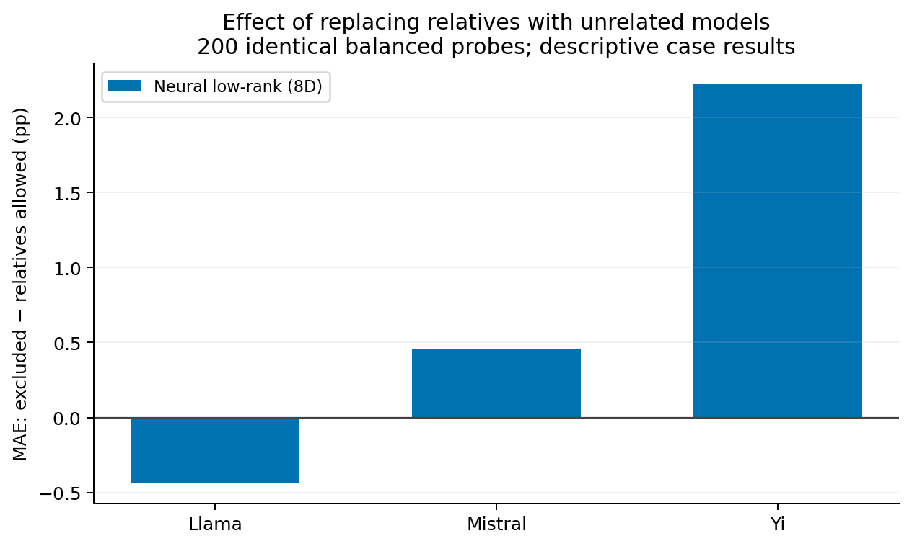

# Exploratory low-rank family follow-up

**Secondary exploratory analysis.** Its dedicated configuration was created after
the main test table had been inspected. The architecture was selected using
main validation models that include two family targets (44 and 47). Original
family numeric defaults and Qwen-only paired prior selection are retained,
but variant selection is not fully family blind. This report does not extend
the original two-variant study's confirmatory scope.

Both conditions use the same held-out models, Qwen validation models, question groups,
probe IDs, and training-pool size (40). The treatment changes which historical models
fill part of that pool. Positive gaps mean allowing relatives reduced MAE.

The fixed family configuration differs from the validation-selected main configuration.
These are within-case comparisons. They do not identify a causal ancestry effect.

## Results at 200 probes

| Family | Predictor | MAE gap (pp) | Models | Seeds |
| --- | --- | ---: | ---: | ---: |
| Llama | Neural low-rank (8D) | -0.438 | 8 | 3 |
| Mistral | Neural low-rank (8D) | 0.453 | 6 | 3 |
| Yi | Neural low-rank (8D) | 2.225 | 3 | 3 |

Seeds are averaged within each target model. Single-family confidence intervals
are suppressed; combined equal-family summaries across three cases are descriptive.
