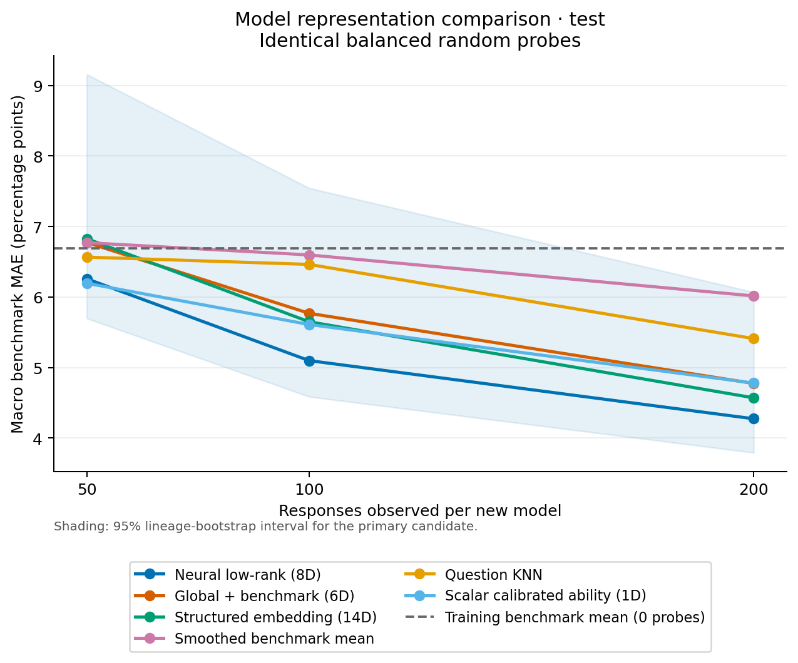
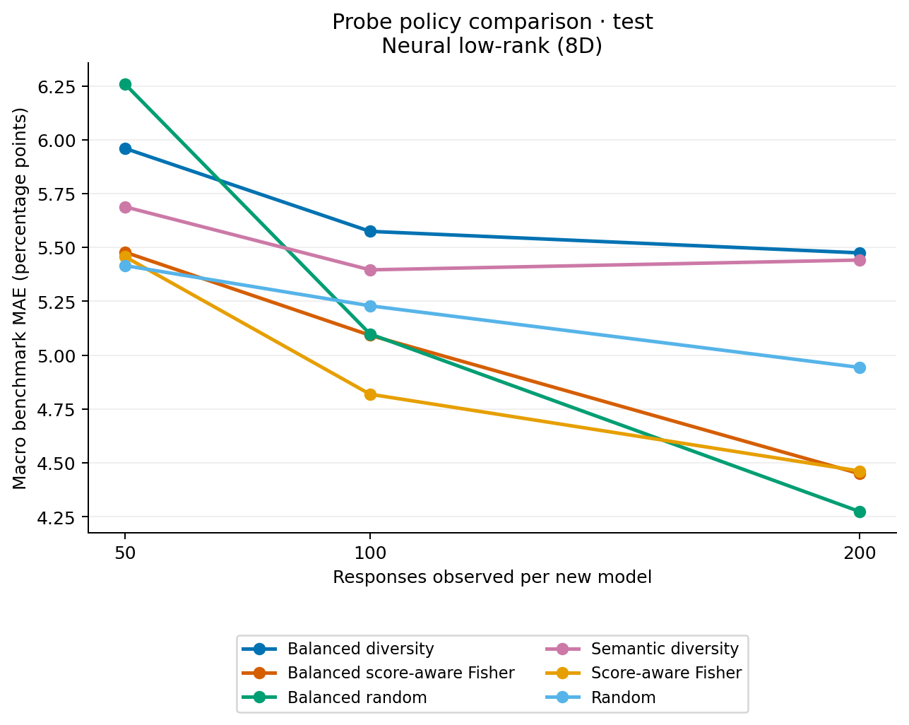
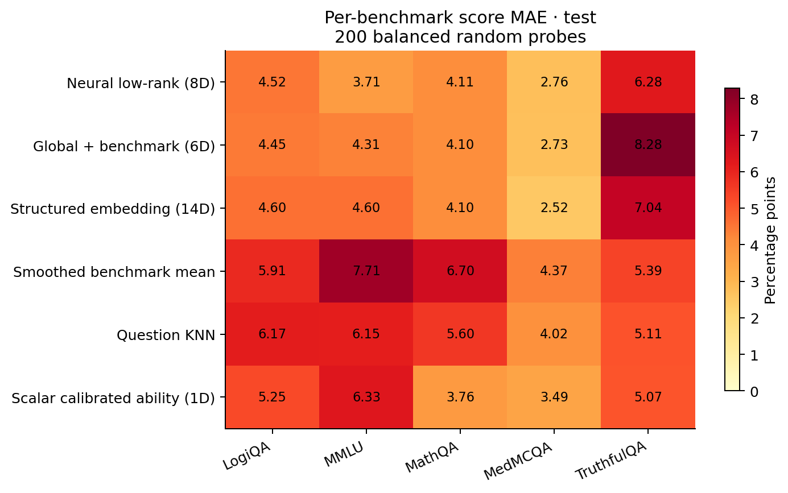
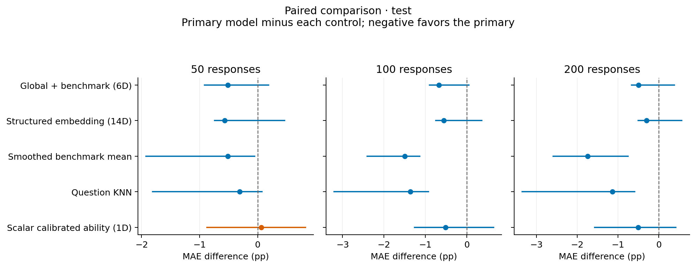
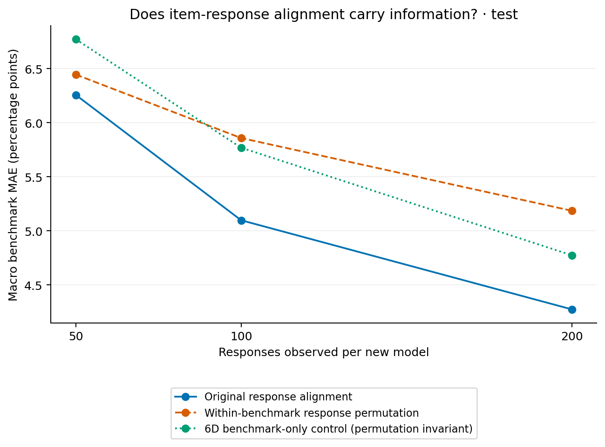

# Benchmark prediction results (test)

Errors below are percentage points. Each benchmark has equal weight.
Seeds are averaged within each held-out model before averaging models.
Intervals resample reviewed lineage groups, and are descriptive when few groups remain.

## Balanced random probes

| predictor | budget | mean | ci_low | ci_high | n_models | n_seeds |
| --- | --- | --- | --- | --- | --- | --- |
| coldstart_neural_lowrank | 50 | 6.258 | 5.697 | 9.157 | 13 | 3 |
| coldstart_neural_lowrank | 100 | 5.099 | 4.587 | 7.545 | 13 | 3 |
| coldstart_neural_lowrank | 200 | 4.274 | 3.794 | 6.069 | 13 | 3 |
| coldstart_rank0 | 50 | 6.773 | 6.320 | 8.867 | 13 | 3 |
| coldstart_rank0 | 100 | 5.769 | 5.386 | 7.503 | 13 | 3 |
| coldstart_rank0 | 200 | 4.775 | 4.362 | 5.878 | 13 | 3 |
| coldstart_structured8 | 50 | 6.827 | 6.408 | 8.637 | 13 | 3 |
| coldstart_structured8 | 100 | 5.649 | 5.330 | 7.164 | 13 | 3 |
| coldstart_structured8 | 200 | 4.571 | 4.152 | 5.501 | 13 | 3 |
| domain_probe_mean | 50 | 6.771 | 5.959 | 10.261 | 13 | 3 |
| domain_probe_mean | 100 | 6.597 | 6.017 | 9.015 | 13 | 3 |
| domain_probe_mean | 200 | 6.016 | 5.595 | 7.501 | 13 | 3 |
| global_probe_mean | 50 | 8.904 | 8.211 | 9.910 | 13 | 3 |
| global_probe_mean | 100 | 7.759 | 7.064 | 9.276 | 13 | 3 |
| global_probe_mean | 200 | 6.982 | 6.489 | 8.873 | 13 | 3 |
| question_knn | 50 | 6.566 | 5.797 | 9.960 | 13 | 3 |
| question_knn | 100 | 6.463 | 5.621 | 9.969 | 13 | 3 |
| question_knn | 200 | 5.411 | 4.539 | 8.936 | 13 | 3 |
| scalar_logit_shift | 50 | 6.195 | 5.589 | 8.612 | 13 | 3 |
| scalar_logit_shift | 100 | 5.611 | 5.188 | 7.371 | 13 | 3 |
| scalar_logit_shift | 200 | 4.780 | 4.420 | 6.604 | 13 | 3 |
| training_domain_mean | 0 | 6.692 | 5.234 | 12.982 | 13 | 3 |

See `paired_comparisons.csv` for paired differences. Negative values favor predictor/policy A.
The saved rows and source hashes allow the report to be regenerated.
