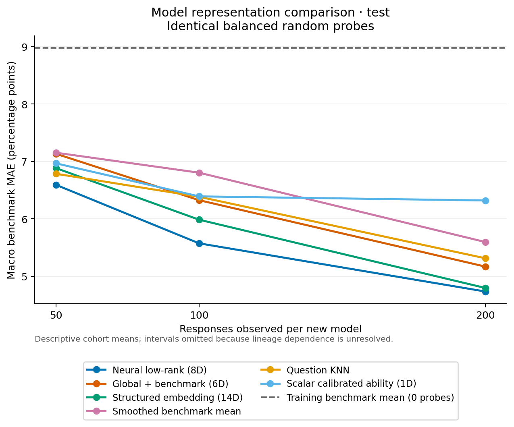

# Frozen coverage on 24 metadata-excluded model IDs

This is a **secondary descriptive analysis in the same EmbedLLM release**.
The 24 models were originally excluded from the curated cohort because their
lineage evidence was insufficient or mixed, before their prediction scores were
examined. None of these IDs was used in any supervised fitting or hyperparameter
selection for the reported predictors.

The study keeps the main experiment's 62 training-model priors, all nine neural
checkpoints, adaptation/baseline settings, 22,475 representative questions,
support/target split, and balanced probe orders unchanged. It performs no
training or tuning on the 24 models. Every model has the required support and
five-benchmark target coverage, and none is dropped.

Macro benchmark-score MAE, **percentage points**, averaged over the 24 IDs and
three seeds:

| Predictor | 50 responses | 100 responses | 200 responses |
| --- | ---: | ---: | ---: |
| Neural low-rank embedding, 8D | 6.59 | 5.57 | 4.74 |
| Structured embedding, 14D | 6.88 | 5.99 | 4.80 |
| Global + benchmark embedding, 6D | 7.13 | 6.33 | 5.17 |
| Scalar calibrated ability, 1D | 6.97 | 6.39 | 6.32 |
| Smoothed benchmark mean | 7.15 | 6.80 | 5.60 |
| Question KNN | 6.79 | 6.38 | 5.31 |
| Training benchmark mean, zero responses | 8.98 | 8.98 | 8.98 |

This supports useful prediction on additional held-out IDs with the same frozen
instrument. The cohort is not an external dataset or a live evaluation of newly
queried LLMs. Unknown ancestry can include near relatives or shared weights, so
the analysis makes no family-blind or population-independence claim. Confidence
intervals are omitted, and these observations are not pooled with the primary
13-model test to enlarge its inferential sample.

The seven frozen predictors and zero-probe reference produce **1,584 model rows
and 7,920 benchmark rows**. The complete values are in [RESULTS.md](RESULTS.md)
and the adjacent CSV files. The independent pre-score and final audits are in
`reports/reviews/`; the locally completed run is
`artifacts/metadata_excluded_cohort_v2`.

The post-primary evidence-blend pilot was rejected using only the original
validation records and was not included in this cohort evaluation. No cohort
performance selected a new method or parameter.
