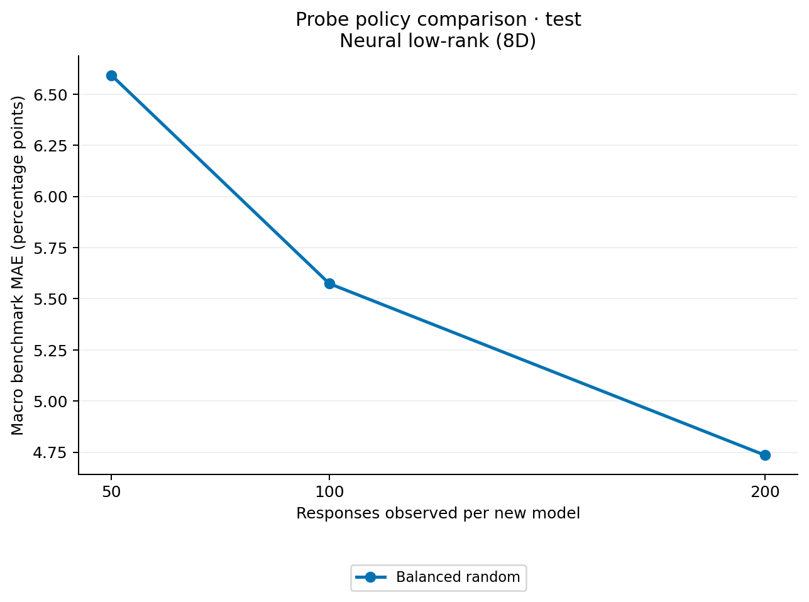
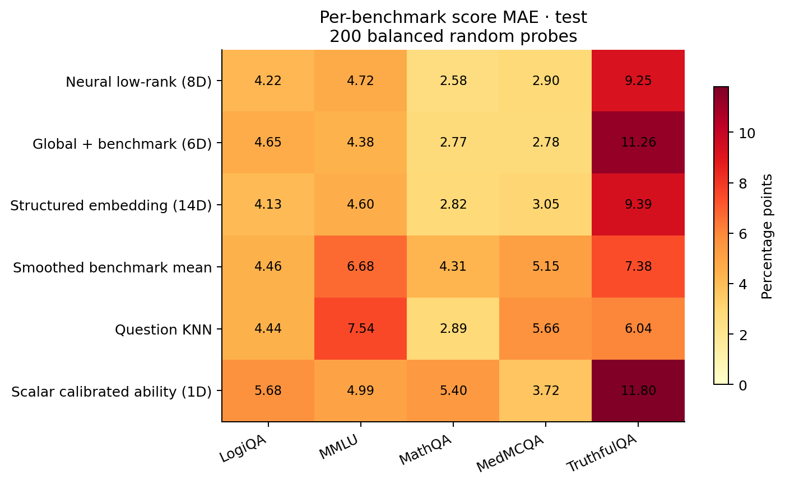
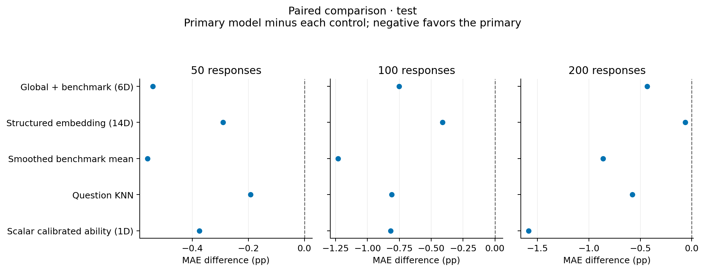

# Benchmark prediction results (test)

Errors below are percentage points. Each benchmark has equal weight.
Seeds are averaged within each held-out model before averaging models.
Not estimated: unresolved lineage dependence.

## Balanced random probes

| predictor | budget | mean | n_models | n_seeds |
| --- | --- | --- | --- | --- |
| coldstart_neural_lowrank | 50 | 6.593 | 24 | 3 |
| coldstart_neural_lowrank | 100 | 5.574 | 24 | 3 |
| coldstart_neural_lowrank | 200 | 4.735 | 24 | 3 |
| coldstart_rank0 | 50 | 7.133 | 24 | 3 |
| coldstart_rank0 | 100 | 6.325 | 24 | 3 |
| coldstart_rank0 | 200 | 5.169 | 24 | 3 |
| coldstart_structured8 | 50 | 6.884 | 24 | 3 |
| coldstart_structured8 | 100 | 5.986 | 24 | 3 |
| coldstart_structured8 | 200 | 4.797 | 24 | 3 |
| domain_probe_mean | 50 | 7.152 | 24 | 3 |
| domain_probe_mean | 100 | 6.804 | 24 | 3 |
| domain_probe_mean | 200 | 5.597 | 24 | 3 |
| global_probe_mean | 50 | 10.817 | 24 | 3 |
| global_probe_mean | 100 | 9.928 | 24 | 3 |
| global_probe_mean | 200 | 9.686 | 24 | 3 |
| question_knn | 50 | 6.785 | 24 | 3 |
| question_knn | 100 | 6.384 | 24 | 3 |
| question_knn | 200 | 5.314 | 24 | 3 |
| scalar_logit_shift | 50 | 6.967 | 24 | 3 |
| scalar_logit_shift | 100 | 6.392 | 24 | 3 |
| scalar_logit_shift | 200 | 6.320 | 24 | 3 |
| training_domain_mean | 0 | 8.977 | 24 | 3 |

See `paired_comparisons.csv` for paired differences. Negative values favor predictor/policy A.
The saved rows and source hashes allow the report to be regenerated.
