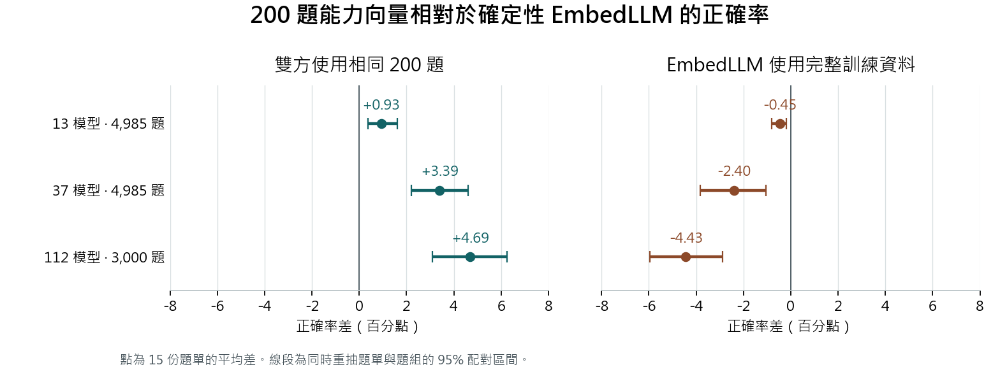
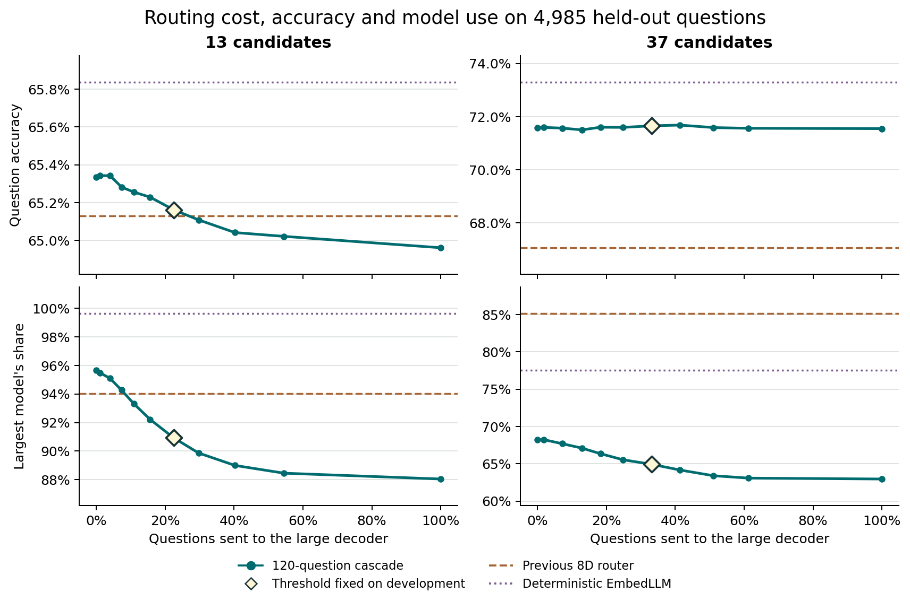

# 以最多 200 題建立新模型的能力 embedding

## 200 題能贏過哪一個 EmbedLLM

把完全相同的 200 道題、模型及答對答錯紀錄交給雙方，每個模型池各重抽 15 份題單。原版使用作者的 TextMF 與確定性推論，每份題單內以三折交叉驗證選 50、200 或 800 個 epoch。新版只用這份答題矩陣估計各候選在不同題型的能力，再用題目文字預測何時該選它。下表為被選模型答對的題數占比。區間同時重抽探題面板與評估題組。

| 候選池與評估題數 | 新版 | 同 200 題 EmbedLLM | 增益，百分點（95% 配對區間） | 勝出題單 |
| --- | ---: | ---: | ---: | ---: |
| 13 模型，4,985 題 | **65.39%** | 64.46% | **+0.93**（+0.36 至 +1.61） | 13/15 |
| 37 模型，4,985 題 | **70.90%** | 67.51% | **+3.39**（+2.20 至 +4.59） | 13/15 |
| 112 模型，官方 3,000 題 | **61.90%** | 57.21% | **+4.69**（+3.08 至 +6.25） | 13/15 |
| 112 模型，另留的 1,503 題 | **67.27%** | 61.73% | **+5.54**（+4.11 至 +6.97） | 15/15 |

13 與 37 模型池的向量各有五項來源能力及八個潛在方向。112 模型池有十項來源能力及八個潛在方向。把原版的訓練樣本改成逐題交錯各模型，13、37、112 模型的相同切分仍分別高 1.14、3.62、4.36 個百分點。原版使用完整資料時，在這三個主要切分為 65.84%、73.30%、66.33%。[13 模型](confirmation/equal_200_audited_13_paired.csv) · [37 模型](confirmation/equal_200_expanded_37_paired.csv) · [112 模型](release_confirmation/coverage/equal_200_paired.csv) · [交錯順序，13 模型](confirmation/equal_200_audited_13_interleaved_paired.csv) · [37 模型](confirmation/equal_200_expanded_37_interleaved_paired.csv) · [112 模型](release_confirmation/coverage/equal_200_interleaved_paired.csv)



原先 **97.57%** 的路由都選 Luminex。為了辨認哪些題目值得換模型，我們讓九組獨立訓練的能力向量各自估計挑戰者相對領先者的優勢，再扣掉九組估計標準差的一半。每個新候選只回答同一組 200 題，九組共享層另使用 75 個歷史模型在 10,748 道題的紀錄。在原先的 3,370 題，保守版正確率為 **65.76%**，完整確定性原版為 **65.37%**，差 **+0.39 個百分點（+0.04 至 +0.74）**，15 份題單全勝。最大模型占比降到 **95.89%**。在另一批 4,985 題為 **65.93% 對 65.84%**，差 **+0.10（−0.19 至 +0.39）**，12/15 勝，最大占比 **96.14%**。保守版是事先指定的次要方法。獨立開發模型上，原先 120 題方法與保守版的整體正確率同為 65.27%，13 模型入口依既定規則採 120 題方法。[九組向量的成績](confirmation/full_ensemble_nominal_results.csv) · [配對區間](confirmation/full_ensemble_nominal_paired.csv) · [開發集選擇](confirmation/ensemble_deployment_selection.json) · [13 模型實際能力向量](../../../artifacts/capability_routing/confirmation/audited_13_nominal-ensemble-full_embeddings.npz)

九組共享模型在本機 RTX 5070 Ti 訓練共 **4 分 21 秒**。歷史輔助模型的特徵準備另計，其中已量測的部分至少 **1 小時 57 分鐘**，整卡峰值 **15,649 MiB**。固定共享模型後，13 個候選的九組向量可同時在 CPU 擬合，從 2.67 秒降為 **0.64 秒**，4,985 題的選擇全部相同。純文字版本直接從 200 題建置，在 112 模型池平均 **1.53 秒**，路由階段在 CPU 上即可運作。這些擬合時間都從已有評分起算。[九組 GPU 訓練紀錄](confirmation/full_ensemble_nominal_training.csv) · [特徵準備](confirmation/selected_feature_cost.csv) · [聯合擬合](confirmation/joint_ensemble_onboarding.csv) · [112 模型擬合成本](release_confirmation/coverage/costs.csv)

觀察獨立保留歷史題的誤差，每 850 步檢查一次，首次無改善就停止該成員。另從頭在同一張顯示卡訓練九組模型，實際更新合計從 **30,600 減至 17,000 步**，訓練時間從 **260.73 減至 109.37 秒**。九組被選中的權重、歷史能力向量與共享題目特徵均逐值相同。新候選的 `confirmation fit` 會使用已完成的提前停止權重。由 2,600 筆評分重建 13 模型池後，48 道原始題目的 CLI 選擇全部重現，含冷啟動共 92.78 秒，整卡峰值 14,223 MiB。[兩次實際訓練比較](confirmation/full_ensemble_nominal_earlystop_cost.json) · [逐成員比對](confirmation/full_ensemble_nominal_earlystop_comparison.csv) · [提前停止模型的 CLI 實測](confirmation/serving_early_shared_ensemble_13.json)

實際提供的 13 模型九組向量使用第一份題單（seed 9200）。在原先 3,370 題，它與完整確定性 EmbedLLM 有 112 次選擇不同，換對 32 題、換錯 21 題，合計 **2,214 對 2,203 題答對**。例如第 1943 題是用間接真值表判斷命題一致性的形式邏輯題，改選 Gemma-2B 後答對。第 2006 題同屬形式邏輯，相同換法卻答錯。在另一批 4,985 題，這份向量換對 40 題、換錯 37 題。將重建後的模型池接上正常 CLI，48 道原始題目合批耗時 **96.51 秒**，全數重現離線選擇，整卡峰值 **14,225 MiB**。[逐題單部署結果](confirmation/ensemble_deployment_audit.csv) · [換對和換錯的原題](confirmation/ensemble_deployment_switches.csv) · [GPU 原始輸入計時](confirmation/serving_full_ensemble_cautious_13.json)

縮短題單的收益取決於模型池。保守九組版本先在 13 個獨立開發模型比較 80、120、160、200 題。160 題的整體正確率為 65.35%，200 題為 65.27%，但最大占比由 85.35% 升至 87.91%，超過預定容許的兩個百分點，最終選用 200 題。嚴格只用候選作答的 `roster-stop` 在 37 模型池平均 **114.67 題**，正確率 **70.08%**，仍高於同池使用 200 題的確定性原版 **67.51%**。在 13 模型池平均 96 題時降為 62.65%，該池完整 200 題得 65.39%。[探題數選擇依據](confirmation/ensemble_probe_budget_design.json) · [開發模型成績](confirmation/ensemble_probe_budget_validation.csv) · [13 模型提早停止](confirmation/audited_13_stopping_results.csv) · [37 模型提早停止](confirmation/expanded_37_stopping_results.csv)

## 原本集中到單一模型的 13 模型池

每個候選模型回答同一份 **120 題**，13 個模型合計 1,560 筆評分。共享解碼器另外使用 75 個歷史模型在 10,748 題上的紀錄學習題型與模型能力的關係。下列 4,985 道保留題整組排除於共享訓練、候選探題與開發選模之外。表內數字是三份獨立探題的平均。正確率指最後選中的模型在該題實際答對的比例。[切分](confirmation/design.json) · [逐種子成績](confirmation/seeds.csv)

| 方法 | 13 模型正確率 | 13 模型最大占比 | 37 模型正確率 | 37 模型最大占比 |
| --- | ---: | ---: | ---: | ---: |
| 舊 8 維路由器，在相同切分重訓 | 65.13% | 94.04% | 67.07% | 85.17% |
| **120 題能力 embedding，完整解碼** | **65.34%** | **93.11%** | **73.06%** | **65.92%** |
| EmbedLLM，作者預設帶噪聲推論 | 63.83% | 85.64% | 70.90% | 59.77% |
| EmbedLLM，已知模型 ID、確定性推論 | 65.84% | 99.64% | 73.30% | 77.51% |
| EmbedLLM 冷啟動，相同 120 題 | 65.85% | 99.95% | 67.03% | 92.30% |
| 事後最佳固定模型 | 65.84% | 100% | 71.35% | 100% |

在 13 模型池，相對作者預設推論，逐題增益為 **+1.51 個百分點**，95% 配對區間 **[+1.00, +1.97]**。相對確定性版本則為 **−0.49 [−0.85, −0.15]**。相對舊 8 維版本，每份題單平均救回 117 題、另換錯 106 題，淨增益 **+0.21 [−0.18, +0.62]**。例如，一題由靜止等加速到 20 m/s 的高中物理題，舊版選 Luminex 答錯，seed 11 的新版改選 Nous-Hermes-13B 答對。此模型池的 97.57% 是舊版在先前 3,370 題的占比，同一批新題的舊版占比是 94.04%。[逐題配對](confirmation/paired.csv) · [換對及換錯的實例](confirmation/switch_examples.csv)

37 模型池的結果比 13 模型池明確。相對舊 8 維版本，平均救回 533 題、另換錯 234 題，正確率高 **5.99 個百分點 [5.21, 6.83]**。相對同 120 題的冷啟動 EmbedLLM，高 **6.03 [5.26, 6.83]**。相對作者預設推論高 **2.16 [1.61, 2.69]**，相對已知 ID 的確定性版本差 **−0.24 [−0.77, +0.31]**。上線使用的單一 seed 11 在 13 與 37 模型池分別為 65.22% 與 72.62%。[完整結果](confirmation/summary.csv) · [逐題配對](confirmation/paired.csv)

完整解碼器在開發模型上選出兩個互補的能力表示。一個在 41 個題型區域內各估計 75 個歷史模型權重及兩個校正值，另一個保留 41 個能力座標與歷史模型校正值。可直接讀取的 NumPy 檔每列對應一個候選，含各區塊名稱與形狀、探題 ID 和候選名稱。透過正常的規劃與擬合指令從 1,560 筆既有評分重建後，全部參數與評估用向量逐值相同，冷啟動擬合為 10.06 秒。共享階段另需八個模型在開發題目上提供特徵，這部分實測累計至少 1 小時 57 分鐘，整卡峰值 15,649 MiB。[13 模型向量](../../../artifacts/capability_routing/confirmation/audited_13_conditional_embeddings.npz) · [重建計時](confirmation/normal_onboarding.json) · [共享特徵各項成本](confirmation/selected_feature_cost.csv)

第一個降低線上成本的方案，以純文字評分的前兩名分差決定是否啟用完整解碼器。13 模型池每題平均從 6.81 次輔助模型計算降到 3.89 次，正確率也從 65.34% 降到 63.16%。37 模型池降到 3.95 次，正確率為 72.96%。這個門檻在開發資料上先固定，上線主方法保留完整解碼。[成本及品質](confirmation/conditional_cost_results.csv) · [配對差異](confirmation/conditional_cost_paired.csv)

從命令列載入重建後的 13 模型池，分三批各送 16 題原始文字，48 次模型選擇都與離線評估相同。首批 119.33 秒，後續每題 6.72 秒，整卡峰值 14,225 MiB。逐一比較全部候選的路由分數，最大絕對差為 0.063。[完整解碼器的實際成本](confirmation/serving_batch_audited_13_conditional.json)

同樣的 48 題一次送完，總時間從 335.70 秒降到 **132.66 秒**，整卡峰值從 14,225 增至 14,239 MiB。48 次選擇仍全部相同，候選分數的平均絕對差為 0.0044。另以離線輔助模型輸出搭配即時文字編碼，最大分差只有 0.00000018。較大的分差出現在重新執行輔助模型的路徑。單題直接從 `route_query.py --prompt` 啟動，實測 83.09 秒。[同批 48 題](confirmation/serving_batch48_audited_13_conditional.json) · [分項重播](confirmation/conditional_replay_components.json) · [單題入口](confirmation/default_single_prompt.json)

第二個省算力的版本從完整解碼器在歷史題目的分數訓練兩個文字模型，只在它們選擇一致且分差足夠時提早結束。各候選池只用 120 題，上線門檻用 3,372 道開發題上與教師的選擇一致率決定。在 37 模型池，**25.86%** 的題目可以提前選定模型，仍有 **99.88%** 的選擇與完整解碼相同，正確率為 **73.07%**。相對完整解碼的差為 +0.007 個百分點，95% 配對區間 [−0.013, +0.027]。13 模型池僅 1.70% 的題目可以提早結束，正確率為 65.28%。設計這個省算力方法時已知道完整解碼的保留集成績。[蒸餾與門檻規則](confirmation/student_cost_design.json) · [兩個模型池的成績](confirmation/student_results.csv) · [配對比較](confirmation/student_paired.csv)

如果讓 360M 與 1.5B 兩個小模型先讀題，完整解碼器便能只處理難以重現教師選擇的問題。固定相同的 120 題能力 embedding 後，`small-helper-economical` 在 4,985 題上只對 **49.00%**（13 模型池）與 **49.05%**（37 模型池）的問題啟動完整解碼。13 模型池正確率 **65.44%**、最高占比 **93.73%**、與教師選擇相同 **99.38%**。37 模型池相對應為 **73.07%、66.10%、99.60%**。每題平均實際需要 4.39 與 4.42 個輔助模型。兩個小模型的作答也供後續完整解碼使用。此項成本實驗設計時已知道教師在本批保留題的表現。[門檻與校準設計](confirmation/small_helper_cost_design.json) · [成績與呼叫數](confirmation/small_helper_results.csv) · [配對比較](confirmation/small_helper_paired.csv)

相同的 48 題一次送進 RTX 5070 Ti，兩小模型版本將 13 模型池的實際時間從 **132.66 秒降到 117.27 秒**，37 模型池從 **120.84 秒降到 111.51 秒**。兩池都重現了該方法離線的 48 次選擇。若先用 CPU 的 MPNet 和文字分類器判斷，`semantic-economical` 在 4,985 題中只需為 44.21% 與 43.30% 的題目啟動完整解碼，正確率為 65.48% 與 73.08%。同一批 48 題的實測為 118.44 秒與 115.33 秒，分別重現 48 與 47 次離線選擇。[兩小模型實測，13 模型](confirmation/serving_batch48_audited_13_small-helper-economical.json) · [37 模型](confirmation/serving_batch48_expanded_37_small-helper-economical.json) · [CPU 初選成績](confirmation/semantic_results.csv) · [13 模型實測](confirmation/serving_batch48_audited_13_semantic-economical.json) · [37 模型實測](confirmation/serving_batch48_expanded_37_semantic-economical.json)

### 用原本 13 個候選實際量測 200 題

13 個候選各讀取 seed 11 的同一組 200 道原始題目，包含 120 題選擇題。12 個量化 GGUF 模型輸出選項機率或簡短答案。CodeLlama-70B 使用原模型的四個 AWQ 權重分片逐層運算，記錄下一個 token 的分數。十個 GPU 工作與三個 CPU 工作耗時合計約 27 分鐘。用這些訊號加上既有二元評分擬合模型能力，4,985 題正確率為 65.92%。只用原有二元評分的同題對照為 66.18%，最大占比 96.59%。評估所選模型的正確率採發布資料集的原始作答評分。[各候選、版本與實測時間](confirmation/measured_selection.json) · [成績](confirmation/measured_results.csv) · [配對比較](confirmation/measured_paired.csv)

再將二元評分版本的共享解碼器保持原樣，換 **15 份獨立題單**，每份均為五項任務各 40 題。13 模型平均 **65.81%**，最大占比 **93.18%**。相對完整確定性原版的 65.84%，差 **−0.03 個百分點 [−0.40, +0.32]**，有 8 份勝出。對完整帶噪聲原版的增益為 **+1.81 [+1.37, +2.25]**，15 份全勝。以另外 6,387 個歷史題目重新訓練共享層、整組排除額外保留題後，13 模型在新的 2,551 題為 67.39%，完整確定性原版為 67.70%。37 模型池為 75.18% 與 76.36%。[`nominal-200` 的實驗規則](confirmation/nominal_replication_design.json) · [固定原共享層](confirmation/nominal_full_history_paired.csv) · [重新訓練共享層](confirmation/nominal_replication_results.csv) · [命令列重建向量](confirmation/nominal_replication_onboarding.json)

同樣的 2,551 題，在六個既有訊號上加入歷史模型 UNA 與 Koala 的實際作答後，13 模型正確率為 67.05%，37 模型為 74.84%。另一個成本實驗把能力空間的 150 個參考點蒸餾進文字解碼器。完全使用 CPU 時，13 模型在 4,985 題得 65.85%，但 99.51% 的題目都選同一模型。37 模型改採有分歧才使用完整解碼的 `nominal-word-gated`，在這批題目的完整解碼比例為 78.02%，正確率為 72.53%。[兩個歷史模型的比較](confirmation/nominal-peers_results.csv) · [文字蒸餾](confirmation/nominal_word_results.csv) · [原始題目 CLI 重播](confirmation/serving_nominal_word_13.json)

### 兩個歷史模型的互補能力

另從官方新保留集取出符合上述五項任務且與三份探題皆無同題幹的 **1,716 題**。每個候選只回答同一份 200 題，從中辨認與領先者、挑戰者行為相近的兩個歷史模型。能力向量用 20 個座標表示這兩個歷史模型在五項任務中同對、同錯或一對一錯時的正確率，再加上 75 個歷史模型權重。共享預測器以 8,457 個其他題目訓練。完整模型在新題上讀八個輔助模型的輸出，純文字版本只需要題目。[實驗設計](confirmation/peer_states_design.json) · [各種子辨認的歷史模型](confirmation/peer_states_modern_costs.csv)

| 新的 1,716 題 | 13 模型正確率 / 最大占比 | 37 模型正確率 / 最大占比 |
| --- | ---: | ---: |
| 95 維能力模型，八個輔助模型 | 66.76% / 94.08% | 75.14% / 70.40% |
| 95 維能力模型，純文字 | 67.00% / 99.01% | 74.90% / 78.77% |
| 只用探題選固定模型 | 67.07% / 100% | 73.48% / 100% |
| 作者完整訓練、確定性 EmbedLLM | 66.90% / 99.18% | 75.06% / 81.18% |
| 同一個原版模型加入推論噪聲 | 62.49% / 76.71% | 69.19% / 45.71% |

原版在所有新題組整組排除後以 112 個已知 ID 重訓，推論時限於相同的 13 或 37 個模型。確定性結果直接來自原模型的兩類分數差，帶噪聲比較從原模型的等價高斯分布抽樣。95 維完整版本相對確定性原版，在兩個池分別差 −0.14 與 +0.08 個百分點，兩個 95% 配對區間都含零。37 模型池的五項任務等權正確率為 63.57%，確定性原版為 59.97%。[完整版本](confirmation/peer_states_modern_results.csv) · [統計區間](confirmation/peer_states_modern_paired.csv) · [純文字對照](confirmation/peer_states_text_results.csv)

另一批 **1,600 個題組**用來檢查主動選題。兩種方法都只看 6,857 題的歷史紀錄。依據尚可能改變排名的題型，先量 80 題，再以 40 題為一批增加，六次實驗全都用到 200 題。13 模型池的主動選題、固定分層題單與完整確定性 EmbedLLM 分別為 **66.10%、66.25%、66.63%**，37 模型池則為 **72.75%、73.27%、74.25%**。以正常 CLI 逐輪加入已評分的答案，13 模型池以 2,600 筆評分重建了相同的 95 維向量。[抽樣與設計](confirmation/active_peer_design.json) · [新題比較](confirmation/active_peer_results.csv) · [逐輪 CLI 重播](confirmation/active_peer_onboarding.json)

用獨立的 UNA-SimpleSmaug-34B 作為第九個訊號，在原題格式下量取它對選項的分數。它在三份探題上的對錯與 13 模型池的 Luminex 有 94% 至 97% 一致。對 1,600 題中小模型有分歧的選擇題加入這項訊號後，13 模型池為 **65.96%**，相同訓練資料的八模型版本為 **66.25%**。37 模型池分別為 **73.48%** 與 **73.27%**。另一種直接估計歷史模型答錯時各候選能否答對的版本，在 4,985 題上用 200 題內校準後，13 模型池為 **65.58%**，37 模型池為 **73.38%**。37 模型池較完整確定性 EmbedLLM 高 0.08 個百分點，95% 配對區間為 [−0.39, +0.59]。[探題上的匹配程度](confirmation/reference_design.json) · [同條件新增一個輔助模型](confirmation/peer_states_mc_paired.csv) · [歷史模型條件估計](confirmation/reference_results.csv) · [配對區間](confirmation/reference_paired.csv)

在另 532 個保留題組上，直接讓 1.5B 輔助模型估計每個完整選項文字的條件機率，並扣除中性提示下的機率。37 模型池的 95 維能力向量從八個訊號的 77.94% 升至 78.20%，完整確定性 EmbedLLM 得 77.07%。增益 1.13 個百分點的 95% 區間為 [−0.13, +2.38]。13 模型池則從 66.29% 降至 66.10%。[獨立題組及方法](confirmation/option_likelihood_design.json) · [逐題比較](confirmation/peer_states_option_paired.csv) · [選項文字校正的原始文獻](https://aclanthology.org/2021.emnlp-main.564/)

下圖為另一個採 140 維向量的 `cascade-budget` 方法。菱形標記開發集先選定的啟動門檻，可讀出多花多少運算換來多少正確率與模型分流。



## 官方 112 模型的確認結果

每個模型回答同一份 200 題，估計 10 個來源能力與 8 個潛在能力方向。此方法使用預訓練的文字與表格模型，三次獨立建模各自遵守 200 題上限。下表是被選模型實際答對的百分比。主要方法先由官方驗證集選定，保留題組的原版 EmbedLLM 重新訓練時也排除了這些題組。[選模規則](release_confirmation/selection.json) · [作者的 TextMF 實作](https://github.com/richardzhuang0412/EmbedLLM/blob/9b276305af1342188c2fc066e41d5dc8bdfea895/algorithm/mf.py)

對每個模型，先估計它在各題目來源的答對率，再從共同答題矩陣扣除來源能力與當題的平均殘差。低秩分解保留 8 個能區分候選模型的方向。進線時，MPNet 與題目格式提供文字特徵，TabICL 根據同一份面板估計新題需要的 8 項能力。最後以模型向量和題目向量的內積排序，潛在能力的權重在面板內做三折估計。[能力向量與評分](../../../scripts/panel_tabular_skills.py)

| 方法 | 每份能力向量的題數 | 3,617 題保留集 | 3,000 題官方測試 |
| --- | ---: | ---: | ---: |
| 18 維面板，CPU 擬合 34.22 秒 | 200 | **70.88%** | **65.37%** |
| 相同 18 維能力，文字核嶺迴歸，CPU 擬合 2.76 秒 | 200 | **71.36%** | **65.40%** |
| 事前指定的面板內四折組合 | 200 | 70.15% | 64.39% |
| 多維試題反應模型，CPU 擬合 9.46 秒 | 200 | 70.14% | 64.18% |
| 先前的 22 維面板 | 200 | 68.25% | 62.52% |
| EmbedLLM，作者預設推論 | 完整訓練集 | 65.37% | 59.80% |
| EmbedLLM，確定性推論 | 完整訓練集 | **71.30%** | **66.33%** |
| 事後最佳固定模型 | — | 64.22% | 60.50% |

18 維面板對原版預設推論的正確率增益，在保留集為 **+5.51 個百分點**，95% 配對區間 **[+4.63, +6.36]**。官方測試為 **+5.57**，區間 **[+4.56, +6.57]**。兩者都是三個種子全勝。對確定性原版，兩組差距分別為 **−0.42**（區間 **[−1.38, +0.43]**）及 **−0.97**（**[−1.99, +0.08]**）。最高單一模型占比分別為 48.39% 與 42.01%。在保留集，對原版預設推論每次平均救回 432 題、另換錯 233 題。實際提供的 seed 11 向量只訓練一次，保留集為 70.50%（同種子原版預設 65.30%），官方測試為 64.50%（同種子原版預設 60.47%）。[保留集成績](release_confirmation/tabular-panel_reserve.csv) · [保留集配對比較](release_confirmation/tabular-panel_reserve_paired.csv) · [官方測試成績](release_confirmation/tabular-panel_test.csv) · [官方測試配對比較](release_confirmation/tabular-panel_test_paired.csv)

逐項比較確定性 EmbedLLM，18 維面板在 ASDiv 算術文字題的保留集高 9.6 個百分點、官方測試高 7.7 個百分點。MedMCQA 的兩個差距分別為 −4.0 與 −6.3 個百分點。這兩個任務顯示，整體接近的正確率仍可能對應到不同的專長判斷。[保留集分項結果](release_confirmation/tabular-panel_reserve_by_benchmark.csv) · [測試分項結果](release_confirmation/tabular-panel_test_by_benchmark.csv)

四折組合在看見自己的官方驗證結果前已指定，組合權重只從每份 200 題內的交叉驗證估計。它在兩個切分的三個種子也都超過作者預設推論，保留集增益 4.78 個百分點、官方測試增益 4.59 個百分點。[四折組合保留集](release_confirmation/crossfit-stack_reserve_paired.csv) · [四折組合官方測試](release_confirmation/crossfit-stack_test_paired.csv)

後續的成本實驗保留相同的 18 維模型能力，改用題目的詞、字元片段和格式估計所需能力。每份 200 題內以三折估計正則化與各能力的權重，擬合和上線均可只用 CPU。相對預設 EmbedLLM，保留集高 **5.99 個百分點**，95% 配對區間 **[5.09, 6.86]**。官方測試高 **5.60 個百分點**，區間 **[4.57, 6.60]**。相對確定性 EmbedLLM，兩組差距分別為 +0.06 與 −0.93 個百分點，兩個區間都含零。最高單一模型占比分別為 51.31% 與 44.24%。上線使用的 seed 11 在兩組答對率為 70.61% 與 64.60%。設計這個成本實驗時已知道前一方法的保留集結果。[成本實驗設計](release_confirmation/text_kernel_design.json) · [保留集配對](release_confirmation/text-kernel_reserve_paired.csv) · [官方測試配對](release_confirmation/text-kernel_test_paired.csv)

同樣以 48 道原始題目、每批 16 題進行實測。純文字版本從開程序到首批結果為 **2.61 秒**，之後平均 **1.71 毫秒／題**。三批共用 2.89 秒，48 次選擇都與離線結果相同。原本的 CPU 完整精度版本首批為 33.86 秒，之後為 481 毫秒／題。這些數字涵蓋選模型，候選模型生成答案的時間另計。[純文字 CLI 計時](release_confirmation/serving_batch_published_112_text-kernel.json) · [神經解碼器 CLI 計時](release_confirmation/serving_batch_published_112_tabular-panel.json)

在 RTX 5070 Ti 上，以相同 200 題重新擬合全部 112 個 TabICL 能力向量的 seed 11 實測為 5.09 秒。從原始問題啟動 CUDA 版本，首批為 10.07 秒，後續每題 24.70 毫秒，整卡峰值 2,620 MiB，48 次選擇都重現離線結果。[CUDA 擬合](release_confirmation/refit_cost_cuda.json) · [CUDA 完整路由計時](release_confirmation/serving_batch_published_112_tabular-panel_cuda.json)

在相同問題、相同能力向量上直接比較兩個解碼器，純文字版本的 micro 在保留集高 0.48 個百分點，95% 配對區間為 [0.09, 0.85]。官方測試高 0.03 個百分點，區間為 [−0.38, 0.45]。[解碼器逐題比較](release_confirmation/decoder_comparison_paired.csv)

把兩邊能用的評分也固定成完全相同的 **200 題 × 112 個模型**，再以作者的批次、50 個 epoch 及原始列順序訓練 TextMF。其預設與確定性推論在官方測試分別為 50.89% 與 49.71%，純文字能力模型為 65.40%。對同題數的確定性原版，官方測試差距為 **+15.69 個百分點 [14.27, 17.06]**，保留集差距為 **+18.27 [16.94, 19.61]**。完整訓練集的確定性成績仍以首表的 66.33% 與 71.30% 為準。[等量訓練成績](release_confirmation/equal_200_summary.csv) · [逐題配對差異](release_confirmation/equal_200_paired.csv)

讓原版在每一份相同的 200 題內，用三折交叉驗證選 50、200 或 800 個 epoch，三份題單分別選出 800、800、200 個 epoch。確定性原版的保留集升到 **60.93%**，官方測試升到 **56.19%**。新版在完全相同的評分預算下，仍高 **10.43 個百分點 [9.42, 11.44]** 與 **9.21 [8.14, 10.26]**，均為三份題單全勝。每份原版的調參、重訓與評估共耗時 312 至 402 秒。[訓練長度選擇](release_confirmation/equal_200_tuned_validation.csv) · [成績](release_confirmation/equal_200_tuned_summary.csv) · [差異與區間](release_confirmation/equal_200_tuned_paired.csv)

### 換 15 份題單後的結果

固定相同演算法，再用 15 個事先指定的種子，各自從 13,876 個可用訓練題組重抽一份 200 題。每份題單只保留同一題幹的一個版本，並排除與所有評估題相交的題幹。原有三份題單和官方 3,000 題分別有 23、25、15 個測試問題共享題幹，與原 3,617 題保留集的交集均為零。15 份新題單在兩個切分的交集都為零。另抽出 2,556 題作為新的評估，涵蓋九項任務，GPQA 在此排除條件下已無尚未使用的題組。[事前規則](release_confirmation/replication_design.json) · [抽樣數量與種子](release_confirmation/replication/sample.json)

| 獨立題單的平均 | 3,617 題保留集 | 3,000 題官方測試 | 2,556 題新保留集 |
| --- | ---: | ---: | ---: |
| 15 份新題單，每份 200 題 | **68.12%** | **61.84%** | **69.93%** |
| 相同題單的 140 題前綴 | 67.72% | 61.49% | 69.63% |
| 完整訓練的預設 EmbedLLM | 65.37% | 59.80% | 66.74% |
| 完整訓練的確定性 EmbedLLM | 71.30% | 66.33% | 73.16% |

200 題版本對預設 EmbedLLM 的勝場依序為 **13/15、12/15、14/15**。同時重抽題單和測試題組的 95% 區間，三組正確率增益分別為 **[+1.44, +4.12]、[+0.70, +3.37]、[+1.77, +4.73] 個百分點**。對確定性原版的勝場則為 2/15、0/15、1/15。原先三個已儲存的 CPU router 原樣應用在新 2,556 題，平均 73.07%，仍高於 15 份新題單的 69.93%。此輪的 seed 11 可用 `release --name text-kernel` 重現。後續上線題單改用下節的新抽樣。[每份題單](release_confirmation/replication/seeds.csv) · [同時考慮抽題與測試的配對區間](release_confirmation/replication/paired.csv)

候選作答成本較高時，可以縮短共同題單。在 40 至 200 題、每次增加 20 題的 CPU 文字版本中，**140 題**是第一個在驗證集上 macro 和 micro 的配對增益下界都大於零的設定。平均擬合 2.03 秒，保留集 69.50%，官方測試 63.39%，兩組的三個種子都超過完整訓練的預設 EmbedLLM。若要求驗證集兩項正確率都與 200 題相差不超過一個百分點，最短是 **180 題**，保留集 71.32%，官方測試 65.02%。兩個可直接使用的名稱為 `text-shortest` 和 `text-near-200`。[題數選擇](release_confirmation/text_kernel_probe_cost/selection.json) · [140 題保留集](release_confirmation/text_kernel_probe_cost/text-budget-140_reserve_paired.csv) · [140 題官方測試](release_confirmation/text_kernel_probe_cost/text-budget-140_test_paired.csv) · [180 題結果](release_confirmation/text_kernel_probe_cost/text-budget-180_test_paired.csv)

將同一條驗證規則套到 TabICL 的 40、80、120、160、200 題設定，最短通過的是 **160 題**，保留集 68.47%，官方測試 62.78%。兩組均為三個種子全勝。需要接近該解碼器 200 題的驗證正確率時，仍須保留 200 題。[TabICL 題數選擇](release_confirmation/probe_cost/selection.json) · [160 題保留集](release_confirmation/probe_cost/tabular-budget-160_reserve_paired.csv) · [160 題官方測試](release_confirmation/probe_cost/tabular-budget-160_test_paired.csv)

### 由題目文字安排 200 題

再換 15 個預先指定的種子，比較相同來源配額的兩種取樣。對照沿一個隨機方向分層抽題，新方法將題意和格式特徵依變異最大的方向反覆分區，再從每區取一題。兩者都固定使用相同的 18 維能力估計方法。額外保留的 1,500 個題組共 1,503 題，來自七項尚有可用題組的任務。[選題規則](release_confirmation/coverage_design.json) · [題組與來源](release_confirmation/coverage/sample.json)

新方法在這批題上得 **67.27%**，原分層抽樣得 **67.75%**。在官方 3,000 題分別為 **61.90%** 與 **62.13%**。改善題意涵蓋度未帶來可辨識的正確率增益。新方法在兩個切分分別贏過完整訓練的預設 EmbedLLM 15/15、14/15 次，贏過確定性 EmbedLLM 4/15、0/15 次。[逐題單結果](release_confirmation/coverage/seeds.csv) · [涵蓋題單及題組差異的配對區間](release_confirmation/coverage/paired.csv)

把作者的 TextMF 在同一份 **200 題 × 112 模型**的評分上重新訓練，以三折選擇 50、200 或 800 個 epoch。新的 1,503 題上，能力向量為 **67.27%**、確定性原版 **61.73%**，差 **+5.54 個百分點 [4.11, 6.97]**，15 份全勝。官方 3,000 題上是 **61.90% 對 57.21%**，差 **+4.69 [3.08, 6.25]**，13/15 勝。兩邊的共同題單與這些評估題均無同題幹。區間同時重抽題單與測試題組。[等量訓練與配對區間](release_confirmation/coverage/equal_200_paired.csv) · [原版各輪數驗證](release_confirmation/coverage/equal_200_validation.csv)

15 份題單的 CPU 擬合平均 1.53 秒。以相同程式分別用字串列舉與編譯過的字元字典評分 4,503 道原始題目，每批 16 題、單執行緒，各跑三次。中位時間由 **4.04 秒降到 2.56 秒**，4,503 × 112 個路由分數逐值相同。正常 CLI 在先前的 48 題上，含冷啟動共 1.80 秒，首批之後每題 0.68 毫秒。從 22,400 筆評分重新建模，也逐值重現了所附的 112 × 18 能力矩陣。[字元計數成本](release_confirmation/coverage/character_tfidf_cost.json) · [原始文字 CLI](release_confirmation/serving_text_kernel_compiled.json) · [完整註冊流程](release_confirmation/coverage/normal_onboarding.json)

再把來源分類器留在模型池中，重用相同排版記號的分數，並加快文字特徵的數字計數。同樣 4,503 題、每批 16 題、單執行緒，三輪交錯計時。每輪清空快取，只用 16 道訓練題暖機。上一版中位時間 **2.51 秒**，現在是 **1.96 秒（每題 0.435 毫秒）**，504,336 個分數全部逐值相同。[實測紀錄](release_confirmation/coverage/text_kernel_serving_cost.json)

若用後驗模擬決定還要不要問下一批，預估追加價值低於 0.5 個百分點就停，平均每模型使用 148.67 題，1,503 題得 65.45%，官方測試得 59.90%。門檻放寬到一個百分點時平均使用 116 題，成績分別為 64.46% 與 59.24%。兩種門檻都以同一份題單的逐步前綴估計。[實際停止題數](release_confirmation/coverage/posterior_stopping.csv) · [成績與配對區間](release_confirmation/coverage/posterior_paired.csv)

## 在其他模型池上重做同一個比較

固定官方驗證集選出的能力估計法，在兩個外部資料集各取三份 200 題的共同面板。下表為各模型池的逐題正確率。兩個 EmbedLLM 對照直接重訓作者的 TextMF，一個使用與新方法完全相同的 200 題，一個使用當地訓練集的全部問題。[實驗設計](external_design.json) · [LLMRouterBench 資料](https://huggingface.co/datasets/NPULH/LLMRouterBench) · [xRouteBench 資料](https://huggingface.co/datasets/ulab-ai/xRouteBench)

| 資料集 | 候選 / 測試題 | TabICL 面板 200 題 | 純文字面板 200 題 | EmbedLLM 同 200 題，預設 / 確定性 | EmbedLLM 完整訓練，預設 / 確定性 |
| --- | ---: | ---: | ---: | ---: | ---: |
| LLMRouterBench | 20 / 1,330 | 73.61% | 73.06% | 72.01% / 72.11% | 74.51% / 75.34% |
| xRouteBench | 15 / 1,141 | 93.46% | 93.05% | 93.46% / 94.10% | 94.30% / 94.83% |

LLMRouterBench 的 200 題能力面板比同題數的確定性與預設 EmbedLLM 分別高 1.50 與 1.60 個百分點，兩個配對區間的下界都大於零。完整訓練集有 1,327 題。xRouteBench 完整訓練有 2,098 題，預設 EmbedLLM 高 0.85 個百分點，95% 區間為 0.03 至 1.64。這兩個外部池中，能力面板的最高單一模型占比分別為 50.30% 和 55.68%。[LLMRouterBench 各項指標](external_confirmation/llmrouterbench_summary.csv) · [配對比較](external_confirmation/llmrouterbench_paired.csv) · [xRouteBench 各項指標](external_confirmation/xroutebench_summary.csv) · [配對比較](external_confirmation/xroutebench_paired.csv)

另將後續的純文字解碼器原樣套用到相同題單，兩個外部池的最高單一模型占比分別為 45.59% 和 48.70%。[LLMRouterBench 逐種子成績](external_confirmation/llmrouterbench_text_seeds.csv) · [xRouteBench 逐種子成績](external_confirmation/xroutebench_text_seeds.csv)

## 第二輪的探題與對照設計

每次實驗使用一份共同題單。以 13 個新模型、120 題為例，總共向候選模型取得 1,560 筆評分，每一個模型只回答 120 題。11、23、37 是三次獨立實驗的探題種子。上線使用其中一次建立的向量，表中數字才取三次的平均。路由器在新題上只能讀題目、候選 embedding 與配置所需的文字特徵。

13 模型是原本集中度約 97% 的主要候選池，37 模型是擴大候選池。第二輪從先前的歷史題庫整組保留 4,985 題，排除舊探題及官方驗證、測試題組。共享訓練剩下 10,748 題。開發時使用 62 個歷史模型，主要評估重訓時可在這些題目加入 13 個開發模型的紀錄，合計 75 個。另以相同配置評估只使用原 62 模型的結果。所有比較方的監督式訓練都排除 4,985 題。這些樣本來自同一批任務與模型家族，Luminex 與一個歷史模型 UNA-SimpleSmaug 都源自 Yi 的 BAgEL 分支。[切分與各來源數量](confirmation/design.json) · [家族來源](../../../data/metadata/model_families.csv)

官方 112 模型另有一個更嚴格的設定。每份 embedding 只使用同一份題單上 112 個候選的評分。部分版本另讀模型名稱、架構或獨立模型對問題的作答特徵。官方 3,000 題驗證集用於比較多個設計，最終確認另保留 3,507 個題組，共 3,617 題，以完整題組排除重複題。作者的 TextMF 也排除這些題組後重新訓練。官方的 3,000 題測試沿用原切分，作為另一個比較點。[官方確認集設計](release_confirmation/design.json) · [作者原始實作](https://github.com/richardzhuang0412/EmbedLLM/blob/9b276305af1342188c2fc066e41d5dc8bdfea895/algorithm/mf.py)

能力向量的其中一種表示包含 75 個歷史模型的相似度、五個題目來源的能力，以及各來源 12 種作答型態的能力，共 140 維。CPU 可以從題目估計這些型態。當預測的不確定性足以改變模型排名，分段路由器才啟動較大的解碼器。兩個解碼器共用同一個候選向量。開發集固定的門檻為 0.13，使用大型解碼器的比例為 45.76%。另一個上線選項沿用專案原本的預期切換收益準則，每次依已量到的答案決定要停止或再量一批，最多 200 題。[開發集成本與品質曲線](confirmation/cascade_validation.csv)

在同一個開發集聯合比較 20 至 120 題與不同啟動門檻後，120 題、門檻 0.18 的版本在 36.06% 的問題上呼叫大型解碼器。開發集正確率為 65.62%，最高單一模型占比為 78.28%。學生解碼器擬合需要 4.40 秒，另需先取得歷史模型的能力預測與教師解碼器。[題數與門檻實驗](confirmation/cascade_budget_validation.csv) · [選定設定](confirmation/cascade_budget.json)

所有候選方法完成後，13 個開發模型選出使用同一份 120 題的兩個解碼器，以 1 比 2 的權重合成逐題分數。第一個解碼器估計新模型在不同題型上接近哪些歷史模型。第二個用 41 維能力向量描述五個來源的能力、16 個跨來源方向與各來源四個方向，再用其他模型的選項分布估計這題需要的能力。開發集上，合成後的 macro 為 55.40%，micro 為 65.88%，最高單一模型占比為 81.79%。[開發集選模紀錄](confirmation/selection.json) · [選項分布模型](../../../src/coldstart/nominal_response.py)

另在保留題揭曉前固定省算力的 `gated-conditional` 設定。它先用同一份 120 題建立的純文字向量評分。前兩名分差至少為 0.03503 時直接選第一名，其他題才呼叫上述完整解碼器。門檻由 13 個開發模型及 28 個強弱不均的子模型池選定。它在開發集省下 20.01% 的完整解碼，micro 是 65.78%。[實驗條件](confirmation/conditional_cost_design.json) · [門檻與開發集成績](confirmation/conditional_cost_selection.json)

官方 112 模型的主要配置使用 10 個來源能力和 8 個潛在方向，每個向量共 18 維。三份獨立的 200 題題單各自在 CPU 擬合，平均需要 34.22 秒。開發集也選出一個平均 9.46 秒的多維試題反應模型。兩者都只需輸入原始問題文字即可路由。這項選法使用官方驗證集的正確率挑選演算法。早先的 22 維對照只在每份探題內決定參數。[正式測試前固定的配置與規則](release_confirmation/selection.json)

同一批 64 題、每批 16 題的 CPU 實測中，快取八個方向的探題表示後，後續 48 題的純路由計算從每題 0.820 秒降到 0.058 秒。64 題的全部候選分數完全相同，建立快取需要 11.14 秒，程序額外記憶體峰值約 779 MiB。這個計時從既有題目向量開始。[一般讀取](release_confirmation/serving_cache_none.json) · [快取讀取](release_confirmation/serving_cache_kv.json)

同機從原始問題執行完整 CLI，另按來源抽取 48 道保留題，每批 16 題，CPU 冷啟動至首批結果為 33.86 秒，其後每題 0.481 秒。48 次選擇全部重現離線結果，112 個候選的最大分數誤差為 0.00000062。這項計時包含 MPNet 文字編碼。[完整 CPU 實測](release_confirmation/serving_batch_published_112_tabular-panel.json)

在 Ryzen 7 7700 上用 `--encoder-precision bfloat16` 執行同一批原始題目，首批為 29.35 秒，之後每題 0.242 秒，48 次選擇均與完整精度相同，候選分數最大差異為 0.00188。單獨在 64 道驗證題比較文字編碼時，float32、bfloat16、int8 分別耗時 28.81、12.17、9.62 秒，後兩者分別重現 64 與 58 個選擇。CLI 的預設精度是 float32。[原始題目計時](release_confirmation/serving_batch_published_112_tabular-panel_bfloat16.json) · [精度比較](release_confirmation/encoder_precision_validation.json)

## 第一輪正式結果

共享解碼器用 62 個歷史模型訓練。以下是驗證選定配置後，在相同 3,370 題、三個獨立探題種子上的平均。每組三個數字依序為 **macro 正確率、micro 正確率、最高單一模型占比**，單位皆為百分比。GPU 時間含選定配置的訓練、必要的順序特徵擷取與配置評分。不同檔位可重用同一條軌跡的 checkpoint。[鎖定配置](selection.json) · [逐檔結果](test_summary.csv)

| 方法 | 每個新模型探題 | 時間 | 全卡峰值 | 13 模型 | 37 模型 |
| --- | ---: | ---: | ---: | --- | --- |
| 舊 8 維 router | 200 | — | — | 53.83 / 65.15 / 97.57 | 57.09 / 68.88 / 84.73 |
| EmbedLLM 冷啟動，驗證最強探題法 | 200 | — | — | 54.61 / 65.36 / 99.91 | 58.53 / 69.29 / 68.64 |
| EmbedLLM 已知 ID，確定性 | 完整訓練池 | — | — | 54.62 / 65.37 / 99.91 | 60.89 / 74.09 / 74.54 |
| 8 GiB，10 分鐘內 | 200 | 7 分 05 秒 | 7.82 GiB | 54.58 / 65.19 / 97.62 | 59.89 / 72.30 / 61.75 |
| 8 GiB，30–60 分鐘 | 200 | 37 分 13 秒 | 7.82 GiB | 54.54 / 65.35 / 99.94 | 60.38 / 74.39 / 75.15 |
| 16 GiB，30–60 分鐘 | 200 | 37 分 36 秒 | 15.28 GiB | 54.54 / 65.36 / 98.62 | 61.10 / 73.88 / 70.62 |
| 8 GiB，超過 1 小時 | 200 | 69 分 13 秒 | 7.82 GiB | 54.52 / 65.30 / 99.20 | 60.24 / 73.00 / 67.30 |
| 16 GiB，超過 1 小時 | 200 | 66 分 38 秒 | 15.28 GiB | 54.52 / 65.34 / 99.38 | 60.17 / 73.44 / 67.75 |
| CPU，固定縮短探題 | 120 | 1.80 秒 | CPU | 54.42 / 65.22 / 97.76 | 59.16 / 73.42 / 84.53 |

13 模型池的最常選模型是 `ConvexAI/Luminex-34B-v0.1`。7 分鐘版本相對舊版平均救回 21.0 題，也把 19.7 題從對換成錯。相對確定性 EmbedLLM 則救回 11.3 題、換錯 17.3 題，micro 差 −0.18 個百分點，95% 配對區間為 −0.45 至 +0.06。37 模型池的同一版本相對舊版平均救回 290.7 題、換錯 175.3 題，micro 增加 3.42 個百分點，區間為 +2.47 至 +4.37。CPU 的 1.80 秒包含從已處理資料建立題庫、產生各組探題、擬合共享解碼器與首次向量預測，使用已發布的 MPNet 題目向量。120 題模型 embedding 平均擬合耗時 0.45 毫秒，兩項時間均另計模型實際作答成本。[配對差異](test_paired.csv) · [各題組的救回與換錯數](test_by_benchmark.csv) · [CPU 計時](cpu_cost.json)

### 只有一組 200 道已評分問題的官方 112 模型比較

在官方 3,000 題測試中，22 維 panel router 的 micro 為 **62.52%**，macro 為 **58.38%**。作者公開推論程式的預設帶噪聲版本分別為 **59.80%** 與 **54.34%**。三個種子全勝，micro 增加 **2.72 個百分點**，95% 配對區間為 **+1.80 至 +3.64**。關閉原碼的推論噪聲後，EmbedLLM 達 **66.33% micro**、**60.44% macro**，200 題版本仍落後 3.81 個 micro 百分點。即使事後知道全測試集最佳固定模型，固定路由也只有 60.50% micro。這個 22 維方法沒有使用其他題目的歷史模型作答。[各種子成績](release112_by_seed.csv) · [配對比較](release112_paired.csv) · [作者的推論程式](https://github.com/richardzhuang0412/EmbedLLM/blob/9b276305af1342188c2fc066e41d5dc8bdfea895/algorithm/mf.py)

在官方另留的 3,000 題驗證集，沿用同一批探題的巢狀子集，80、120、160、200 題的 micro 依序為 **57.97%、62.27%、63.53%、62.66%**。原始帶噪聲及確定性版本為 59.62% 與 66.23%。各個短面板在自己的題目內交叉驗證並估計能力。改用來源比例及細分主題抽取另一批 200 題，再加入 Rasch 能力估計供面板內選擇，正式測試為 61.66% micro，低於第一批面板。這些設定各自使用的模型回答分開計數。[題數實驗](release112_budget_validation.csv) · [另一種抽題法](stratified/release112_by_seed.csv)

## 實驗設計

專案的主要問題是新模型上線後，router 能不能從它回答過的少量題目，判斷下一題該交給誰。主要測試沿用專案的家族與題組切分。共享解碼器使用 62 個歷史模型在 15,733 題的作答。另用 13 個驗證模型及 3,372 題選超參數、訓練時間和顯卡檔位。最後固定所有選擇，讓 13 個未參與訓練與選模的模型在 3,370 題競爭。擴充實驗加入 24 個系譜資料不足的模型，使用同一批測試題。專案過去的 8 維 router 也評過這批題目。[既有實驗](../learning/test_summary.csv)

每次試驗內，所有候選模型各回答同一組最多 200 題。13 個候選共需要 2,600 個二元評分，37 個候選共需要 7,400 個。三個選題種子 11、23、37 分別建立三個獨立的 router，再平均結果。對進線問題，router 只看文字，挑出一個候選模型。這份離線評估依資料集保存的答對與否計分。

**Macro** 先算各 benchmark 的正確率，再讓五個 benchmark 各占 20%。**Micro** 是所有問題中答對的比例，也是原論文的整體路由指標。**最高占比** 是每次試驗中，分到最多題目的單一模型所占的比例。配對區間在各 benchmark 內重抽問題 2,000 次，固定候選模型與三組 onboarding 題目。[EmbedLLM 論文第 5.2 節](https://proceedings.iclr.cc/paper_files/paper/2025/file/bf5e4b85d203481d6e37bd32d9600162-Paper-Conference.pdf)

## 能力 embedding 如何決定路由

在共同探題上，我們用答對率、逐題答對與答錯的一致程度，以及與歷史模型的距離來估計新模型的能力。核嶺迴歸把每個新模型表示成 62 個歷史模型的權重，再用 5 個維度修正它在不同 benchmark 的偏差。進線時，文字解碼器預測 62 個歷史模型在這一題上的表現與 5 個 benchmark 的機率。與新模型的 67 維向量取內積，即可比較候選模型。各模型的流量由預測分數決定。

GPU 軌跡把 Qwen2.5 的末端 transformer blocks 和共享輸出層一起微調。模型同時學習預測 62 個歷史模型的正確率、同一題上模型之間的相對表現，以及題目所屬 benchmark。另一種解碼器固定 Qwen 權重，從原題、變換過的選項或技能問題、難度問題擷取三組文字特徵，再學習預測歷史模型的表現。CPU 版本使用資料集原有的 MPNet 題目向量。

驗證選擇優先保留 macro、micro 都超過同場兩個 EmbedLLM 對照、且最高占比低於舊 8 維 router 的候選。符合條件者再依 0.65 × macro 加 0.35 × micro 排序。各檔位分別選擇，硬體成本含同一條訓練軌跡到該 checkpoint 的時間。兩種解碼器組合時，兩段實測時間相加，顯存取依序執行的最高值。GPU 數據來自這台 RTX 5070 Ti 的 NVIDIA 全卡專用顯存讀值，取樣間隔為 0.5 秒，包含 Windows 桌面用量。

8 GiB 軌跡使用 Qwen2.5-0.5B、192 tokens、每次更新 64 題。16 GiB 軌跡使用 Qwen2.5-3B、256 tokens、每次更新 36 題。因此跨檔比較同時包含模型大小與計算量的差異。同一條軌跡的 checkpoint 可用來觀察延長訓練的效果。共享解碼器可以重用，新模型上線只需採集自己的探題評分與擬合能力向量。

## EmbedLLM 對照

- **EmbedLLM-200** 使用原始 232 維 TextMF 架構與 62 個歷史模型，另加可在相同探題上擬合新模型向量的 MAP 步驟。以驗證集選出其探題策略與先驗強度，另保留與新方法逐題相同的對照。
- **EmbedLLM-known** 讓原始架構預先見到候選模型 ID，使用專案訓練池中可用的完整作答資料。主表保留關閉推論噪聲的版本。附表另列作者公開 router 預設的高斯噪聲行為。
- **Panel-only-200** 在相同的 13 或 37 個候選上，只使用該次共同探題的作答來學習能力向量與文字解碼器。探題按 benchmark 與種子選定。每個候選向量含 5 個 benchmark 能力與 12 個其他能力方向。`panel-calibrated-200` 另用開發用的 13 個模型選擇兩個共用縮減係數，以降低少量探題對專長差異的高估。兩者都可從同一個 200 題面板建立整個候選池。
- **官方 112 模型實驗** 回到作者發布的原始切分與十個 benchmark。比較方直接載入作者的 TextMF 類別，按原始順序與超參數重訓，在官方的 3,000 題測試集用作者的 forward 選模型。新方法每個種子只使用一組 200 題及 112 個模型對這組題目的作答。它將各來源的能力與 12 個剩餘能力方向組成 22 維向量。題目來源由探題文字格式推估，超參數在這 200 題內做四折選擇。原始發布資料中重複的模型與題目紀錄採作者 evaluator 最後一列覆蓋的規則。[作者程式](https://github.com/richardzhuang0412/EmbedLLM/blob/9b276305af1342188c2fc066e41d5dc8bdfea895/algorithm/mf.py) · [發布資料](https://huggingface.co/datasets/RZ412/EmbedLLM/tree/266ae3e180ccb533c86afc9cfb2f5db99d171aea)

官方切分的重訓使用 29,673 個不同訓練提示、3,814,272 筆原始作答、50 個 epoch、batch 2,048、Adam 學習率 0.0001 與權重衰減 0.00001。本機訓練耗時 88.19 秒。原始碼的 router 呼叫帶噪聲的 forward，同一類別也支援關閉噪聲的確定性評分。兩種方式都實際讓 112 個候選模型競爭。論文圖上的數字與本地重訓成績分開解讀。

## 使用已訓練的 router

在本機專案目錄執行以下 PowerShell 指令。第一個查詢使用開發集選出的預設配置和 13 個候選模型。第二個讓 37 個模型競爭，輸出每個模型的分數。JSON 的 `selected` 欄位是本題選中的模型名稱。新環境先安裝適合硬體的 PyTorch，再用 `python -m pip install -e ".[routing,routing-research]"` 安裝完整路由研究環境。

```powershell
$python = ".\tmp\routing-text-env\Scripts\python.exe"
& $python scripts/route_query.py --prompt "Which argument best explains the conclusion?"
& $python scripts/route_query.py confirmation route --roster expanded_37 --scores --prompt "Which argument best explains the conclusion?"
```

新模型一起匯出共同題單，各自填寫 `response` 欄，答對填 1，答錯填 0。下例讓 A 和 B 競爭。`graded.csv` 是填完兩個模型答案評分後的 `probes.csv`。`fit` 產生可重複使用的模型能力向量，之後可以直接送入新題。

```powershell
& $python scripts/route_query.py confirmation plan --model-name A --model-name B --output artifacts/new_model/probes.csv
& $python scripts/route_query.py confirmation fit --responses artifacts/new_model/graded.csv --output artifacts/new_model/pool.joblib
& $python scripts/route_query.py confirmation route --pool artifacts/new_model/pool.joblib --prompt "What follows from these assumptions?"
```

指定 `--method panel-200` 或 `--method panel-120` 可只用這個候選池的探題評分建立 embedding。`plan` 和 `fit` 使用相同方法。`--method adaptive` 從 60 題開始，將已評分的 CSV 用 `plan --responses` 再送入，直到輸出 `stop_reason` 為 `evpi` 或達到 200 題。測試批次可用 UTF-8 JSON Lines，每行一個含 `prompt` 字串的物件，題目原有的換行以 `\n` 保存。

```powershell
Get-Content questions.jsonl -Encoding utf8 | & $python scripts/route_query.py confirmation route --stdin-json --batch-size 16
& $python scripts/route_query.py release --name primary --prompt "What follows from these assumptions?"
& $python scripts/route_query.py release --name text-kernel --prompt "What follows from these assumptions?"
Get-Content questions.jsonl -Encoding utf8 | & $python scripts/route_query.py release --stdin-json --batch-size 16
```

官方 112 模型的 `release` 預設使用 200 題純文字 CPU 解碼器及與評估集題幹分離的第一份題單（seed 8800）。這份實際提供的向量在官方 3,000 題答對 **64.57%**、最高模型占比 **35.90%**。另留的 1,503 題為 **68.93%、29.21%**。正常 CLI 收到 48 道原始題目，48 次選擇均相同。指定 `--name primary` 可重現原先由驗證集選定的 TabICL，`--name text-kernel` 使用原來的 seed 11。各版本都採 18 維座標。舊題單的向量另附於此。[上線版本的逐題單成績](release_confirmation/coverage/seeds.csv) · [預設命令實測](release_confirmation/coverage/default_routing.json) · [原 seed 11 向量](../../../artifacts/capability_routing/release_confirmation/published_112_embeddings.npz)

要將自己的候選模型套用到十項任務的 CPU 方法，以下指令使用 15 份乾淨題單的第一份（seed 8800）。將 `probes.csv` 的各模型評分填入 `graded.csv`。`pool.joblib` 可直接路由，`abilities.npz` 含各模型能力、座標名稱與題號。既有 112 模型在這份題單的能力向量也可下載。[seed 8800 能力向量](../../../artifacts/capability_routing/release_confirmation/coverage/embeddings_8800.npz)

```powershell
& $python scripts/route_query.py release plan --model-name A --model-name B --output artifacts/new_release/probes.csv
& $python scripts/route_query.py release fit --responses artifacts/new_release/graded.csv --output artifacts/new_release/pool.joblib --embeddings artifacts/new_release/abilities.npz
& $python scripts/route_query.py release route --pool artifacts/new_release/pool.joblib --scores --prompt "What is the probability of rolling an even number?"
```

五項任務的 13 與 37 模型池可選 `roster-200` 使用純文字能力向量、`roster-stop` 逐批提早停止，或 `nominal-ensemble-cautious-full` 使用共享歷史模型的保守九組向量。新模型可在 `confirmation plan`、`confirmation fit` 和 `confirmation route` 以同一個方法名稱操作。

```powershell
& $python scripts/route_query.py confirmation route --method roster-200 --scores --prompt "What follows from these assumptions?"
& $python scripts/route_query.py confirmation route --method nominal-ensemble-cautious-full --scores --prompt "What follows from these assumptions?"
```

原本五項任務的 13 與 37 模型池支援 `confirmation route --method small-helper-economical`。使用 200 題的六輔助模型版本為 `--method nominal-200`，僅用當次候選池、在 CPU 建立能力向量的版本為 `--method roster-200`。這兩個 200 題版本的 `plan` 與 `fit` 使用同一份題單，預設 seed 9200。

第一輪的固定硬體檔位可經由 `capability` 子命令使用。例如要分別儲存兩個候選的第一輪能力向量，`a.csv` 和 `b.csv` 來自同一份探題。

```powershell
& $python scripts/route_query.py capability plan --output artifacts/new_model/probes.csv
& $python scripts/route_query.py capability fit --responses artifacts/new_model/a.csv --model-name A --output artifacts/new_model/a.npz
& $python scripts/route_query.py capability fit --responses artifacts/new_model/b.csv --model-name B --output artifacts/new_model/b.npz
& $python scripts/route_query.py capability route --embedding artifacts/new_model/a.npz --embedding artifacts/new_model/b.npz --prompt "What follows from these assumptions?"
```

要改用其他檔位，`plan`、`fit` 與 `route` 都帶入相同的 `--tier`。既有 37 模型候選池存於 `artifacts/capability_routing/expanded_37_<tier>.npz`。官方 112 模型候選池另有獨立入口。

```powershell
& $python scripts/run_embedllm_release.py --phase route --seed 11 --prompt "What follows from these assumptions?"
```

## 重現訓練與評估

以下指令使用已備妥的專案資料、`artifacts/main_v2` 家族切分及既有 8 維基準。新環境先安裝適合顯卡的 PyTorch，再執行 `python -m pip install -e ".[routing]"`。兩條 GPU 軌跡依序執行，使顯存測量涵蓋當時實際運作的整張卡。各個時間檔共用較長軌跡中已完成的 checkpoint。

```powershell
& $python scripts/train_embedllm_reference.py --mode historical
& $python scripts/train_embedllm_reference.py --mode known_ids
& $python scripts/train_capability_router.py --cap 8
& $python scripts/train_question_views.py --size small
& $python scripts/train_capability_router.py --cap 16
& $python scripts/train_question_views.py --size expert
& $python scripts/train_topic_readout.py
& $python scripts/evaluate_capability_router.py --phase validation
& $python scripts/evaluate_capability_router.py --phase panel-fit
& $python scripts/evaluate_capability_router.py --phase freeze
& $python scripts/evaluate_capability_router.py --phase test
```

官方實驗先從上方作者連結下載同一版本的 `algorithm/mf.py`，存成 `artifacts/capability_routing/release112/upstream_mf.py`。`view-support` 僅處理各組探題文字，`view-test` 依鎖定的選擇處理測試文字。

```powershell
& $python scripts/run_embedllm_release.py --phase prepare
& $python scripts/run_embedllm_release.py --phase original
& $python scripts/run_embedllm_release.py --phase view-support
& $python scripts/run_embedllm_release.py --phase freeze
& $python scripts/run_embedllm_release.py --phase view-test
& $python scripts/run_embedllm_release.py --phase test
```

正式的 18 維配置、短面板與外部資料轉移可用以下指令重現。原版 EmbedLLM 的 `--reserve` 參數會整組排除確認題後重訓，再用同一份題單評分。

```powershell
& $python scripts/confirm_release_panel.py --phase prepare
& $python scripts/run_embedllm_release.py --phase original --official-mf artifacts/capability_routing/release112/upstream_mf.py --out artifacts/capability_routing/release_confirmation --report reports/routing/capability/release_confirmation --reserve artifacts/capability_routing/release_confirmation/reserve.npz
& $python scripts/confirm_release_panel.py --phase fit --name tabular-panel --tabular
& $python scripts/confirm_release_panel.py --phase score --name tabular-panel --tabular --part reserve
& $python scripts/confirm_release_panel.py --phase score --name tabular-panel --tabular --part test
& $python scripts/optimize_release_probes.py
& $python scripts/confirm_release_panel.py --phase fit --name text-kernel --text-kernel
& $python scripts/optimize_release_probes.py --text-kernel
& $python scripts/compare_release_equal_budget.py
& $python scripts/compare_release_equal_budget.py --tune-epochs
& $python scripts/confirm_external_panels.py --dataset llmrouterbench
& $python scripts/confirm_external_panels.py --dataset xroutebench
```

在本機已備妥第二輪的共享解碼器、探題面板和歷史題目特徵後，可用下列指令鎖定 13 與 37 模型的配置並重做比較。`--cohorts 75 62` 會在同一份保留題上評估主要的 75 個歷史模型及原規模 62 個歷史模型兩種設定。

```powershell
& $python scripts/select_confirmation_router.py
& $python scripts/fit_roster_panel.py
& $python scripts/fit_roster_panel.py --text-only
& $python scripts/fit_roster_panel.py --text-only --development
& $python scripts/gate_conditional_router.py --phase validation
& $python scripts/evaluate_routing_confirmation.py --cohorts 75 62
& $python scripts/gate_conditional_router.py --phase confirmation
& $python scripts/distill_conditional_router.py
```

在上述資料與共享特徵準備完成後，以下指令重現兩組 15 面板的比較與成本實驗。`compare_coverage_equal_budget.py` 需要原作者的 `upstream_mf.py`。五項任務的完整訓練原版對照另依各實驗的 `reserve.npz` 整組排除評估題並重訓。

```powershell
foreach ($phase in 'prepare','fit','score') { & $python scripts/cover_release_panels.py --phase $phase }
& $python scripts/compare_coverage_equal_budget.py --device cuda
foreach ($phase in 'fit','score') { & $python scripts/posterior_release_budget.py --phase $phase }
foreach ($phase in 'prepare','fit','score','full-history') { & $python scripts/replicate_nominal_profiles.py --phase $phase }
foreach ($roster in 'audited_13','expanded_37') {
    foreach ($phase in 'panel','native','score') { & $python scripts/compare_roster_equal_budget.py --roster $roster --phase $phase }
    foreach ($phase in 'native','score') { & $python scripts/compare_roster_equal_budget.py --roster $roster --phase $phase --order interleaved }
    foreach ($phase in 'fit','score') { & $python scripts/stop_roster_budget.py --roster $roster --phase $phase }
}
& $python scripts/compare_coverage_equal_budget.py --order interleaved --device cuda
foreach ($phase in 'train','evaluate') { & $python scripts/ensemble_nominal_profiles.py --full-history --phase $phase }
& $python scripts/ensemble_nominal_profiles.py --full-history --phase train --early-stop
& $python scripts/ensemble_nominal_profiles.py --full-history --phase compare-training
foreach ($phase in 'train','select') { & $python scripts/select_ensemble_budget.py --phase $phase }
foreach ($phase in 'select','score') { & $python scripts/select_ensemble_probe_count.py --phase $phase }
& $python scripts/distill_helper_gate.py --semantic
foreach ($phase in 'train','evaluate') { & $python scripts/distill_nominal_embeddings.py --phase $phase }
```
