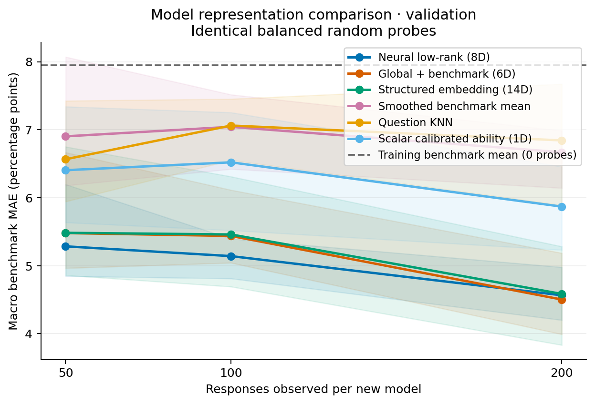
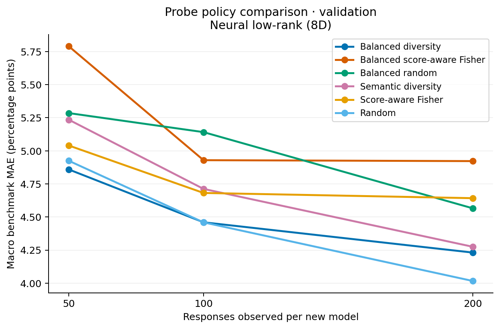
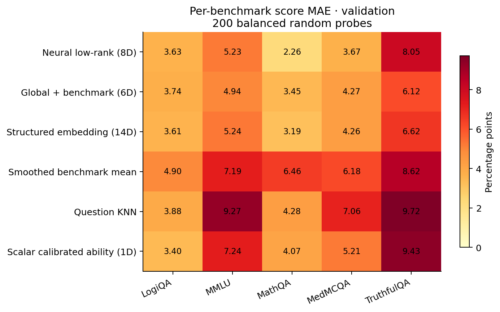

# Benchmark prediction results (validation)

Errors below are percentage points. Each benchmark has equal weight.
Seeds are averaged within each held-out model before averaging models.
Intervals resample reviewed lineage groups, and are descriptive when few groups remain.

## Balanced random probes

| predictor | budget | mean | ci_low | ci_high | n_models | n_seeds |
| --- | --- | --- | --- | --- | --- | --- |
| coldstart_neural_lowrank | 50 | 5.285 | 4.846 | 6.197 | 13 | 3 |
| coldstart_neural_lowrank | 100 | 5.141 | 4.811 | 5.397 | 13 | 3 |
| coldstart_neural_lowrank | 200 | 4.565 | 4.200 | 4.979 | 13 | 3 |
| coldstart_neural_lowrank_permuted | 50 | 6.039 | 5.398 | 6.780 | 13 | 3 |
| coldstart_neural_lowrank_permuted | 100 | 6.048 | 5.103 | 6.393 | 13 | 3 |
| coldstart_neural_lowrank_permuted | 200 | 5.832 | 5.481 | 6.059 | 13 | 3 |
| coldstart_rank0 | 50 | 5.480 | 4.965 | 6.666 | 13 | 3 |
| coldstart_rank0 | 100 | 5.438 | 5.043 | 6.113 | 13 | 3 |
| coldstart_rank0 | 200 | 4.503 | 3.992 | 5.186 | 13 | 3 |
| coldstart_rank0_permuted | 50 | 5.480 | 4.965 | 6.666 | 13 | 3 |
| coldstart_rank0_permuted | 100 | 5.438 | 5.043 | 6.113 | 13 | 3 |
| coldstart_rank0_permuted | 200 | 4.503 | 3.992 | 5.186 | 13 | 3 |
| coldstart_structured8 | 50 | 5.484 | 4.860 | 6.750 | 13 | 3 |
| coldstart_structured8 | 100 | 5.460 | 4.692 | 6.311 | 13 | 3 |
| coldstart_structured8 | 200 | 4.585 | 3.833 | 5.283 | 13 | 3 |
| coldstart_structured8_permuted | 50 | 5.445 | 4.777 | 6.522 | 13 | 3 |
| coldstart_structured8_permuted | 100 | 5.708 | 4.614 | 6.462 | 13 | 3 |
| coldstart_structured8_permuted | 200 | 4.982 | 4.176 | 5.543 | 13 | 3 |
| domain_probe_mean | 50 | 6.902 | 6.178 | 8.070 | 13 | 3 |
| domain_probe_mean | 100 | 7.042 | 6.422 | 7.516 | 13 | 3 |
| domain_probe_mean | 200 | 6.669 | 6.143 | 6.986 | 13 | 3 |
| global_probe_mean | 50 | 10.076 | 7.111 | 11.286 | 13 | 3 |
| global_probe_mean | 100 | 10.118 | 6.770 | 11.270 | 13 | 3 |
| global_probe_mean | 200 | 9.472 | 6.836 | 10.968 | 13 | 3 |
| question_knn | 50 | 6.565 | 5.943 | 7.426 | 13 | 3 |
| question_knn | 100 | 7.061 | 6.551 | 7.452 | 13 | 3 |
| question_knn | 200 | 6.843 | 5.890 | 7.671 | 13 | 3 |
| scalar_logit_shift | 50 | 6.405 | 5.636 | 7.340 | 13 | 3 |
| scalar_logit_shift | 100 | 6.520 | 5.520 | 7.254 | 13 | 3 |
| scalar_logit_shift | 200 | 5.869 | 5.231 | 6.457 | 13 | 3 |
| training_domain_mean | 0 | 7.947 | 6.985 | 10.555 | 13 | 3 |

See `paired_comparisons.csv` for paired differences. Negative values favor predictor/policy A.
The saved rows and source hashes allow the report to be regenerated.
